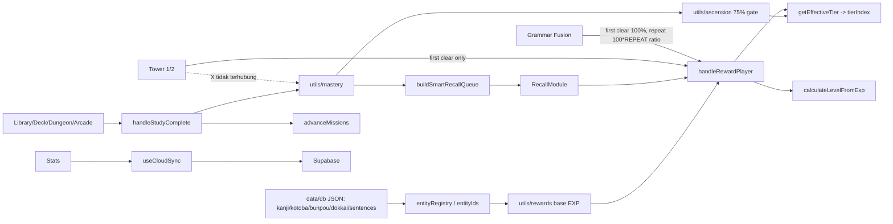

> **DIGANTIKAN** oleh [`docs/audit/`](audit/README.md) (audit lengkap & mutakhir, 2026-10-13). File ini adalah snapshot awal di commit `8ae7fc1` dan dipertahankan sebagai riwayat; beberapa temuan di bawah sudah diperbaiki di PR #14.

# SevnQuest — System Audit (read-only)

Tanggal audit: 2026-10-13 · Branch: `ccr-45fec575-9x86pe` · HEAD `8ae7fc1`
Tidak ada kode aplikasi yang diubah. Satu-satunya perubahan: file ini (belum di-commit) dan `node_modules/` (di-ignore git) untuk menjalankan tes.

**Legenda bukti:** ✅ terverifikasi dari kode/eksekusi · 🔶 inferensi · ❓ belum bisa dipastikan.

**Cakupan jujur:** audit mendalam dilakukan pada jalur state/progres/EXP/mastery/SRS/Recall/cloud sync/Supabase/Tower/Fusion/Arcade/Dungeon reward. Area yang hanya dipindai permukaannya (bukan baca penuh): UI Library (Kanji/Kotoba/Bunpou detail), Buku Saku + AI Deck, Leaderboard UI, Text-Study/Immersion (`engine/textStudy`), `api/captions.ts`, `public/sw.js`, isi konten Tower 2, dan dataset JSON. Repo ±300 file kode / ±90k baris (belum termasuk JSON data).

---

## A. Executive Summary

1. **Sumber kebenaran EXP = satu "sink" tanpa ledger**: `handleRewardPlayer(exp, gold)` di `src/hooks/usePlayerActions.ts`. Tidak ada log event, tidak ada idempotency key, tidak ada batas harian. Semua pencegahan farming bersifat per-fitur dan tidak seragam.
2. **Angka EXP tersebar**: komentar di `utils/rewards.ts` melarang "angka EXP per mode", tetapi ≥10 tempat memakai konstanta hard-coded (mis. `onRewardPlayer(15, 10)` di `ConjugationDojoView`, `BunpouDetailModal`; 25/10 di `UniversalEntityModal`; tabel rank di `StarSentenceRushModal`; `benar·30 + combo·10` di `ConjugationSpeedRushModal`).
3. **Banyak sistem "tampak ada" tetapi tak terhubung**: modul Stage/Dokkai/Choukai/Boss lama (`BossBattleModule`, `DokkaiModule`, `ChoukaiModule`, `KanjiModule`, `KotobaModule`, `BunpouModule` ≈ 2.600 baris) **tidak diimpor di mana pun**; `stageProgress` tidak pernah ditulis; engine Tower lama (`components/tower/*`, `engine/tower/{combat,round}`) tidak dimount; HP/damage/gems/shop/tier perks tidak punya efek di UI hidup.
4. **Misi tidak bisa tamat/ tidak akurat**: `wm_01`, `wm_02`, `wm_03`, `wm_04`, `dm_04` hampir/tidak mungkin maju (lihat §I-3).
5. **Cloud**: tabel `user_saves` **tidak ada di database remote** → save penuh jatuh ke fallback `auth.users.user_metadata.cloud_save` (ikut JWT). Konflik antar perangkat: pemenang = sisi dengan EXP lebih tinggi, EXP sisi kalah hilang.
6. **Tes**: 148/148 lulus, `tsc --noEmit` bersih. Tetapi **tidak ada tes** untuk `rewards.ts`, `recordItemAttempt/Interaction`, `cloudMerge`, `derivedState`, `ascension`, mission logic, atau `handleRewardPlayer`.

---

## B. Tech Stack & Architecture ✅

| Lapisan | Teknologi |
|---|---|
| UI | React 19, Vite 6, TypeScript 5.8, Tailwind 4, `motion`, `lucide-react`, `canvas-confetti` |
| Bahasa Jepang | `wanakana` (IME), `hanzi-writer` + `hanzi-writer-data` (+ stroke JSON lokal `public/data/kanji-strokes` 4.994 file, `kana-strokes` 486) |
| Backend | Supabase (`@supabase/supabase-js`) — auth (email + Google ID token), tabel leaderboard/weekly/mastery/activity; proxy same-origin `/supabase-proxy` (`functions/supabase-proxy`) dengan fallback ke `supabase.co` |
| Serverless | `api/captions.ts` (caption YouTube), `api/deck-topic.ts` (deck AI via penyedia OpenAI-compatible); salinan `functions/api/*` untuk Cloudflare |
| PWA | `public/sw.js`, `manifest.webmanifest`, `PwaInstallModal` |
| Tes | `tsx --test` (18 file, semua terdaftar di `npm test`) |
| Deploy | Cloudflare Pages saja (build dari `main`); `vercel.json` dan script `gh-pages` sudah dihapus |
| State | **Tanpa library**: 4 `useState` di `App.tsx` (`stats`, `stageProgress`, `dailyMissions`, `weeklyMissions`) + hooks (`usePersistence`, `useCloudSync`, `useDailyRollover`, `usePlayerActions`). Tab keep-alive di `app/MainContent.tsx` |

Struktur: `src/app` (shell), `components/*` (per fitur), `engine/*` (logika murni: recall, fusion, tower1, tower, search, textStudy, morphology, syntax…), `data/*` (konten + konfigurasi RPG), `state/*` (load/derive/canonicalize), `utils/*` (rewards, mastery, ascension, decks…), `lib/supabase.ts` (semua akses backend).

```mermaid
flowchart TD
  UI[Komponen latihan: Library / Buku Saku / Dungeon / Arcade / Tower1-2 / Recall]
  UI -->|onRewardPlayer exp,gold| HRP[handleRewardPlayer]
  UI -->|onCompleteStudyItem| HSC[handleStudyComplete]
  UI -->|onRecordInteraction| HRI[handleRecordItemInteraction]
  UI -->|onItemReviewed / onCompleteRecallSession| REC[Recall handlers]
  HSC --> HRP
  HSC --> MIS[advanceMissions]
  HSC --> MAS[recordItemAttempt -> itemMastery]
  HRI --> MAS2[recordItemInteraction]
  REC --> MAS
  REC --> HRP
  HRP --> ST[(stats: totalExp, level, tier, gold)]
  MAS --> ST
  MAS2 --> ST
  ST --> LS[(localStorage nihongo_quest_player_stats_v2, debounce 1s)]
  ST --> CLOUD[useCloudSync: debounce 3s, min 30s]
  CLOUD --> SB[(Supabase: user_metadata.cloud_save, leaderboard, user_mastery)]
  ST -->|buildSmartRecallQueue turunan| RQ[recallQueue]
  QUIZ[QuizEngine / Kanji canvas] -->|sendScoreEvent| RPC[(submit_score_event[_v2])]
```

---

## C. Complete Feature Inventory

Status: **C** complete · **P** partial · **U** UI-only/terputus · **D** dead code · **?** unknown.

| Fitur | Lokasi | Status | Bukti / catatan |
|---|---|---|---|
| Home (Castle): rekomendasi, streak, shortcut Recall | `components/home/HomeView.tsx` | C ✅ | |
| Karakter/Status: level, atribut, ascend, potion, dojo | `modals/CharacterStatusModal.tsx`, `utils/recovery.ts`, `utils/ascension.ts` | P | Atribut STR/AGI tak berefek di UI hidup (§E-6). HP hanya turun lewat `handleHpDamage` yang tak dipanggil komponen hidup ✅ |
| Misi harian/mingguan | `MissionsView`, `data/rpg/missions.ts`, `advanceMissions` | P | §I-3 |
| Library Kanji / Kotoba / Bunpou / Soal | `components/library/*` | C 🔶 | Detail modal tulis, kuis, bookmark |
| Library Choukai | `QuestionLibraryView` | U | `CHOUKAI_ENABLED=false` (`data/featureFlags.ts`) ✅ |
| Dokkai | hanya via `QuestionLibraryView` & `TextStudyDungeonModal` | P | `DokkaiModule` mati |
| Tryout / simulasi JLPT | `QuestionLibraryView` + `dungeon/DungeonBattleModule` | C 🔶 | 27 official + sampel tryout |
| Recall SRS | `learning/RecallModule.tsx`, `engine/recall/*`, `utils/mastery.ts` | C ✅ | multi-engine (canvas, flashcard, fusion, konjugasi, listening, MCQ) |
| Buku Saku (deck) + AI deck | `components/deck/*`, `api/deck-topic.ts` | C 🔶 | Runner flashcard & menulis |
| Arcade (5 mode) | `components/arcade/*` | C ✅ | Kanji Speed, Kotoba Guess, Sudden Death, Conjugation Rush, Star Sentence |
| Dungeon (11 jenis) | `components/dungeon/*`, `utils/dungeonGenerator.ts` | C ✅ | termasuk Grammar Fusion, Text Study, Immersion (YouTube) |
| Tower 1 (16 lantai) + Tower 2 (hingga 100) | `components/tower1/*`, `engine/tower1/*`, `data/tower1`, `data/tower2` | P ✅ | satu-satunya menara yang di-mount (`WorldView` hanya impor `Tower1View`) |
| "Nihongo Tower" lama (HP, boss gate, skill tree, rewardEngine) | `components/tower/*`, `engine/tower/*`, `hooks/useTowerRuntime.ts` | D ✅ | tak diimpor dari `WorldView`/`App`; hanya `towerCloudState` yang masih memanggil `loadTowerProgress` dll. |
| Leaderboard all-time & mingguan | `components/leaderboard/*`, `lib/supabase.ts` | C 🔶 | |
| Settings, Auth (email + Google), Onboarding, PWA | `settings`, `auth`, `tutorial`, `pwa` | C 🔶 | |
| Peta Dunia/Stage (`world/stages.json`, `maps.json`) | `data/world/*` | D ✅ | `stageProgress` tak pernah ditulis (hanya reset/load/merge) |
| Shop | tipe `'shop'` di `BottomNavigation` | U ✅ | tidak ada tab/komponen |
| Gems | `PlayerStats.gems` | U ✅ | tak ada misi ber-`rewardGems`; `FloorReward.gems` (engine lama) tak dipakai |
| Boss Battle | `learning/BossBattleModule.tsx` | D ✅ | tak diimpor |
| `TemplateDeckDetailView` | 2 baris | D ✅ | stub |

---

## D. Detailed System Map (ringkas per modul)

**Boot & state.** `main.tsx` → lazy `App.tsx` → `loadInitialStats()` (localStorage `nihongo_quest_player_stats_v2`, canonicalize ID, `applyLevelFromExp`). `recallQueue` adalah data turunan: tidak disimpan/dikirim (`stripDerivedStats`), dihitung ulang dari `itemMastery`.

**Identitas materi.** `data/entityIds.ts` + `state/canonicalizeStats.ts`: alias lama (`bunpou_001→w1d1g1`) dan kanji-by-karakter dikanonikkan; progres ganda digabung (record terbaru menang).

**Rollover** (`hooks/useDailyRollover.ts`): saat mount, tab visible, tiap 60 dtk. Reset misi harian per tanggal lokal, mingguan per ISO-week lokal. Streak naik **hanya karena app dibuka di hari baru** (bukan karena belajar) ✅.

**Recall** (`engine/recall/session.ts`): `sessionSize 10`, `dailyCap 40` jawaban/hari, `newPerDay 10` materi baru, "Latihan Ekstra" 5 soal tanpa batas jumlah putaran (`RecallModule` memakai `extraPlan` tiap kali). Penghitung `recallDaily` ikut tersimpan lokal & cloud (`mergeRecallDaily`, ambil maks).

**Dependency map:**



---

## E. EXP & Reward Economy

### E-1. Rumus inti ✅

| Hal | Rumus | Lokasi |
|---|---|---|
| Level | `L = max(1, floor((-1 + sqrt(9 + 0.16·EXP)) / 2))`; EXP awal level L = `25L² + 25L − 50` (diverifikasi konsisten satu sama lain) | `data/rpg/tiers.ts` `calculateLevelFromExp`, `getLevelInfo` |
| Poin atribut | 3 per level naik | `ATTRIBUTE_POINTS_PER_LEVEL` |
| MaxHP / MaxMP | `100 + 10·L + 15·VIT` / `40 + 5·L + 8·INT` | `calculateMaxHp/Mp` |
| Tier (10) | ambang EXP total: 0, 1.200, 4.000, 10.000, 22.000, 45.000, 80.000, 135.000, 210.000, 320.000 | `RPG_TIERS` |
| Gerbang Ascend | tier tertahan di 1/3/5/7 sampai kanji, kotoba, bunpou level itu **masing-masing ≥75%** *dan* rata-rata ≥75% (`mastery ≥70%` atau status MASTERED/PERFECTED, atau — bila belum punya record — masuk `studyStats.*.uniqueIds`) lalu pemain klik Ascend | `utils/ascension.ts` |
| Base EXP kanji | `levelBase(KANA/SUUJI 12, N5 20, N4 30, N3 45, N2 65, N1 90) + round(strokes·2.5)` | `getKanjiBaseExp` |
| Base EXP kotoba | `levelBase(15/22/32/48/65) + 2·panjang + 5·jumlahKanji` | `getKotobaBaseExp` |
| Base EXP bunpou | `levelBase(25/35/50/70/95) + 5·subFormulas` | `getBunpouBaseExp` |
| Multiplier engine | flip 0.005 · flashcard 1.0 · quiz 1.2 · writing 1.5 · sentence 2.0 · recall 1.0 · arcade 0.35 | `ENGINE_EXP_MULTIPLIER` |
| Menulis | `performanceFactor = clamp(mult/1.2, 0.8, 1.25)`; mult = 1.2 +0.35 (tanpa watermark) +0.25 (tanpa animasi) +0.25 (0 salah) +0.10 (waktu wajar) − penalti | `calculateWritingReward` |
| Kuis | `max(10, round(benar · basePerSoal(N5 18…N1 70) · 1.2 · akurasi(1.3 / 1.1 / 1.0 / 0.8) · (1 + 0.005·INT)))`, gold `max(5, exp/2)` | `calculateQuizReward` |

### E-2. Tabel sumber EXP

| Aktivitas | Kondisi | EXP dasar | Bonus / batas | Pemberi reward | Status |
|---|---|---|---|---|---|
| Flashcard flip (Buku Saku, Dungeon) | tiap balik ke belakang | `base·0.005` (≈0,1–0,5) | — | `handleStudyComplete` → `handleRewardPlayer` | **Tidak pernah masuk**: `Math.round(totalExp + exp)` membuang pecahan <0,5 (§I-1) ✅ |
| Flashcard next | tiap kartu "Next" | `base·1.0` | gold 0 | sama | ✅ |
| Penyelesaian runner flashcard/menulis | akhir sesi | tampilan `max(15,…)`/`max(30,…)` | bonus lantai **hanya** dibayar bila `onCompleteStudyItem` tidak ada; di `BukuSakuView` keduanya ada → lantai tak dibayar, tapi layar menampilkannya | `DeckFlashcardRunner`, `DeckWritingRunner` | UI≠realita ✅ |
| Menulis kanji / kosakata | per lembar selesai (`hasRewardedRef` per sheet) | `base·1.5·perf` | gold 0 (hasil kalkulasi); fallback konstanta 25/10, 20/10, 15/5 bila `reward` kosong | `recordKanjiWriting` → `handleStudyComplete`; `UniversalEntityModal` memakai `onRewardPlayer` langsung (jalur lain!) | ✅ |
| Kuis Library (QuizEngine) | akhir sesi | lihat E-1 | INT +0,5%/poin | `calculateQuizReward` | ✅ |
| Soal tunggal Bunpou detail | benar pertama per modal | **15 EXP / 10 gold tetap** | `rewardClaimed` per mount modal → buka-tutup modal = reward lagi | `BunpouDetailModal:329` | farming ❌ (§I-5) |
| Kuis di `UniversalEntityModal` | benar | **15 / 5 tetap** | `quizScoreRecorded` per mount | `:771` | farming |
| Conjugation Dojo | **setiap jawaban benar** | **15 / 10 tetap** | tanpa batas | `ConjugationDojoView:101` | farming ❌ |
| Drill soal (QuestionLibrary) | akhir drill | `calculateQuizReward` | — | `handleStudyComplete('questions')` | ✅ |
| Tryout/simulasi | akhir ujian | dari `DungeonBattleModule` | ❓ rumus belum ditelusuri penuh | `onCompleteStudyItem('tryOuts')` | 🔶 |
| Dungeon (7 tipe) | akhir (semua lantai) | akumulasi `expAward` default **20 / 10 per lantai** | `Number(...toFixed(2))` lalu dibulatkan di sink | `advanceToNextFloor` | ✅ |
| Arcade Kanji Speed | tiap jawaban benar | `max(1, round(base·0.35))` | — | `KanjiSpeedRushModal:205` | ✅ |
| Arcade Kotoba Guess | tiap benar | idem | — | `KotobaGuessModal:261` | ✅ |
| Arcade Sudden Death | tiap benar | `round(base·0.35)` + `min(streak,10)` | gold `5 + streak/2` | `:243` | ✅ |
| Arcade Conjugation Rush | akhir 60 dtk | `max(30, benar·30 + combo·10)` | gold `max(20, benar·25 + score/50)` | `:232` | hard-coded ✅ |
| Arcade Star Sentence | klaim akhir | rank: C30 / B60 / A90 / S120 / SS160 / SSS200 | `hasClaimedReward` per mount | `:307-326` | hard-coded |
| Recall | per jawaban benar dikumpulkan, dibayar **saat sesi selesai** | `base·1.0` (`sentence`: ·2.0) `+ round(INT·2)` flat | gold `benar·15`; batas 40 jawaban/hari tapi "Latihan Ekstra" tak terbatas | `handleCompleteRecallSession` | keluar di tengah sesi = mastery tersimpan, EXP hilang ✅ |
| Grammar Fusion | akhir stage | `stage.reward · faktor` | **clear pertama 100%**, ulang `REPEAT_REWARD_RATIO`; mode bebas: Set in-memory per sesi | `GrammarFusionModal:366-386` | progres di `localStorage nq_fusion_progress` **tidak ikut cloud** ✅ |
| Tower 1/2 | **clear pertama** lantai | `spec.reward` (40–140+ EXP, gold = ½) | tidak ada reward ulang | `Tower1View.finish` | progres ikut cloud (union) ✅ |
| Text Study Dungeon | akhir | `quiz·base` per soal | ❓ | `TextStudyDungeonModal:108` | 🔶 |
| Misi harian/mingguan | klaim | harian 75–120 EXP; mingguan 400–600 | `claimed` flag | `handleClaimMission` | §I-3 |
| Streak harian / achievement / combo global | — | — | **tidak ada** | — | tidak ditemukan ✅ |

### E-3. Perbedaan rumus yang tersebar
- Bonus INT berbeda-beda: kuis `+0,5%/poin` (`rewards.ts`), Sakubun `+2%/poin` (`SakubunStudio:142`, via `BunpouModule` yang mati), Recall `+2 EXP flat/poin` per sesi (`RecallModule:286`) bahkan bila 0 benar. Default prop `playerInt = 10` di beberapa komponen vs `stats.int` default 0.
- Dua jalur reward untuk satu aktivitas yang sama: `UniversalEntityModal` (langsung `onRewardPlayer`, tanpa mastery/misi) vs `KanjiLibraryView` (via `handleStudyComplete`).
- Tower lama punya `RewardEngine` (flawless +30%, streak +5%…) yang tak dipakai.

### E-4. Pencegahan farming — ringkasan
Ada: Tower1 first-clear; Fusion first-clear (tapi lokal); `hasRewardedRef` per sheet; `rewardClaimed`/`quizScoreRecorded`/`hasClaimedReward` (state komponen, hilang saat remount); dedupe 3 dtk di `recordItemInteraction` untuk event non-quiz.
Tidak ada: ledger/idempotency di `handleRewardPlayer`; batas harian EXP; dedupe untuk `handleStudyComplete`; batas per-materi per-hari.

### E-5. Tier "perks" — tidak diimplementasikan ✅
Teks seperti "+30% seluruh EXP", "Bonus EXP Misi Harian +20%", "Gratis 1 MP Potion setiap login", "Kerusakan 2x Boss" hanya ditampilkan (`PlayerProfileModal`); grep tidak menemukan efeknya di kalkulasi.

### E-6. Atribut
INT: bonus kuis (lihat E-3). VIT/INT: hanya menaikkan maxHp/maxMp. STR: hanya dipakai `BossBattleModule` (mati). AGI: tak dipakai ✅. HP: turun hanya via `handleHpDamage` (dipanggil modul mati); MP dipakai Recall 50/50 (10) & kuis hint (15), **tidak ada regenerasi** selain Dojo (bayar gold) dan naik level ✅. Gold sink satu-satunya: Dojo.

---

## F. Learning & Mastery System

**Model record** `ItemMasteryRecord` (`types/content.ts`): `status` LOCKED/AVAILABLE/LEARNING/COMPLETED/MASTERED/PERFECTED, `masteryPercentage`, `masteryLevel` 1–5, `attemptsCount`, `writing/flashcard/quiz/recall/viewCount`, `consecutivePerfects`, `mistakeCount`, `nextReviewDue`, `reviewIntervalDays`, `errorPatterns`, dll.

| Peristiwa | Fungsi | Efek |
|---|---|---|
| Buka materi | `recordItemInteraction('view')` | hanya `viewCount`; tidak masuk Recall |
| Menulis/flashcard di Library | `recordItemInteraction` | counter + `lastReviewedAt`; **bukan attempt**, mastery 0 |
| Kuis nyata | `recordItemAttempt` | skor, SRS penuh |
| Pertama kali | `ratio≥0.85 → COMPLETED/lv2`, mastery `round(ratio·70)`, interval 1 (2 bila perfect) |
| Berikutnya | mastery = 20% best-decay(half-life 30 hari) + 25% akurasi terkini + 20% streak perfect/5 + 15% freshness + 20% kontekstual (hanya bila ada) |
| Status | PERFECTED: ≥98% & ≥3 attempt & ≥2 perfect & interval ≥4; MASTERED: ≥80% & ≥2 attempt; COMPLETED: ratio≥0,7 atau mastery≥60 |
| Interval SRS | `[1,2,4,7,14,30]`; perfect → naik; <60% → 1 hari; sebagian → turun satu anak tangga |
| Jawaban Recall | `handleItemReviewed`: benar = 7/7, salah = 4/7 (<0,6 → reset 1 hari) |

Antrean Recall (`buildSmartRecallQueue`, maks 30): CRITICAL (mistake≥3 / TM<45), WEAK (TM<70 / LEARNING), REVIEW (jatuh tempo), MAINTAIN (>5 hari), plus `NEW_UNTESTED` untuk materi yang hanya pernah dilatih tanpa kuis. Definisi eksplisit "dipelajari" di UI: `hasPracticed` (counter>0). `visited ≠ attempted`: dipisahkan dengan baik ✅. **`completed/mastered/perfected` memakai ambang tetap, tanpa tes unit.**

Catatan inkonsistensi:
- Flashcard di Buku Saku/Dungeon memanggil `handleStudyComplete(…, score 1, total 1, 'flashcard')` ⇒ `recordItemAttempt` **perfect attempt** setiap flip *dan* setiap Next (2 attempt sempurna per kartu). Ini bertentangan dengan filosofi `recordItemInteraction` ("flashcard bukan skor") dan mendorong `consecutivePerfects`, interval SRS, MASTERED lebih cepat. Lihat §I-2.
- Ascension memakai `masteryPercentage ≥ 70` **atau** keberadaan ID di `studyStats.*.uniqueIds` sebagai "dikuasai" — buka satu kali menulis pun dihitung bila belum ada record.
- Dokkai/Choukai: struktur ada (`ItemMasteryRecord.category`) tetapi tak ada jalur UI hidup yang menulis `contextualSuccessCount` ⇒ 20% komponen kontekstual praktis tak aktif; `weakness 'dokkai_context_fail'` tak terisi.
- **Tower 1/2 tidak memperbarui mastery/Recall/studyStats**: `onTowerMastery` diterima `WorldView` tapi tak dipanggil ✅.

---

## G. Database & Data Flow

### G-1. Penyimpanan klien (localStorage) ✅
| Key | Isi | Cloud? |
|---|---|---|
| `nihongo_quest_player_stats_v2` | seluruh `PlayerStats` (tanpa `recallQueue`) | ya |
| `nihongo_quest_stage_progress_v2`, `…daily…_v2`, `…weekly…_v2` | stage (mati), misi | ya |
| `n3quest_last_daily_reset` / `weekly_reset` / `last_cloud_sync` | penanda | tidak |
| `nq_tower1_progress`, `nq_tower1_rooms` | Tower 1/2 | progres lantai ya (`towerCloudState`), room tidak |
| `nq_fusion_progress` | Grammar Fusion | **tidak** |
| tower lama: progress, skill tree, achievements, checkpoint | `engine/tower/*` | progress/skills/ach ya |
| cache leaderboard, saved words, visitor id, onboarding | — | tidak |

### G-2. Supabase — **terverifikasi langsung (read-only metadata)** pada proyek `iokhdhqnpslpwsxspvaj` ("sevnquestnihongo", URL cocok dengan default di `lib/supabase.ts`)

| Tabel | RLS | Baris | Dipakai kode? |
|---|---|---|---|
| `leaderboard` (PK `user_id` text; `exp_credit_at`) | ON | 707 | ya |
| `weekly_scores` | ON | 233 | ya (dibaca; ditulis RPC) |
| `user_mastery` (PK `id`; user_id uuid) | ON | 224 | ya, upsert `onConflict user_id,entity_type,entity_id` ⚠️ lihat I-9 |
| `user_activity` | ON | 14.996 | ya (hanya `quiz_answer`/`kanji_write`) |
| `score_event_log` | ON | 4.960 | via RPC |
| `app_visitors` | ON | 1.837 | `lib/visitors.ts` |
| `kanji` 2.306, `vocabulary` 8.635, `grammar` 915, dan ±14 tabel konten/kurikulum/relasi (`stage`, `map`, `question`, `sentence`, `reading`, `listening`, `user_srs`, …) | ON | 0 kecuali tiga yang disebut | **tidak dibaca aplikasi** (konten dari JSON lokal) |
| **`user_saves`** | — | **tidak ada** | kode menulis ke sini dulu ⇒ gagal → fallback `user_metadata` |

Migrasi remote: `sec03_1a_prep`, `sec03_1b_functions`, `sec03_1c_grants`, `sec03_purge_guest_leaderboard`, `app_visitors_counter`, `sec03_2_lock`, `sec03_2b_revoke_leftover_grants`. **Tidak ada folder `supabase/` / file SQL di repo** (kode merujuk `supabase/migrations/20261001_secure_leaderboard_and_saves.sql` — tidak ditemukan). Jadi skema hanya bisa direproduksi dari proyek live ❓.

❓ **Belum diperiksa** (butuh SQL/dashboard): isi fungsi RPC (`submit_score_event_v2`, `upsert_leaderboard_entry`), policy RLS per tabel, nilai env `VITE_SECURE_LEADERBOARD` di Vercel (jika bukan `'true'`, klien memakai jalur lama yang menerima `p_user_id` dari klien), apakah `user_mastery` punya unique index pada `(user_id,entity_type,entity_id)`.

### G-3. Alur sinkron
Lokal → debounce 1 dtk (+flush saat tab hidden). Cloud: login → `loadGameFromCloud` (dual-read `user_saves` + `user_metadata`, yang `updatedAt` lebih baru menang) → rekonsiliasi: `cloudWins = cloudExp > localExp || cloudLevel > localLevel`. Sisi pemenang menyumbang semua skalar (gold, gems, inventory, atribut, streak…); `itemMastery`, `userDecks`, `recallDaily`, `stageProgress`, tower di-union. Autosave ≥30 dtk, ditahan sampai `cloudHydrated`. Kegagalan load di-throw agar cloud tidak tertimpa ✅ (desain bagus).

---

## H. Feature Dependency Map
Lihat diagram di §D. Ringkas: hampir semua fitur latihan → `handleStudyComplete`/`handleRewardPlayer`; Recall bergantung pada `itemMastery`; Ascension bergantung pada `itemMastery` + `studyStats`; Tower/Fusion hanya bergantung pada `handleRewardPlayer` (terputus dari mastery); Leaderboard bergantung pada `totalExp` + `studyStats.*.total`.

---

## I. Bugs, Risks & Technical Debt

| # | Risiko | Temuan & bukti | Dampak | Cara verifikasi |
|---|---|---|---|---|
| 1 | **Tinggi** | EXP pecahan hilang: `handleRewardPlayer` memakai `Math.round(totalExp + expGained)` (`usePlayerActions.ts:~54`). Flip flashcard memberi `base·0.005` (0,1–0,5) ⇒ selalu dibulatkan ke 0. UI tetap menampilkan popup `+0.xx` dan `accumulatedExp` | Mikro-EXP flip tidak pernah diberikan; layar hasil menyesatkan | Unit test: `Math.round(1000+0.095)===1000`; main flashcard dan lihat `totalExp` |
| 2 | **Tinggi** | Flip & Next flashcard → `recordItemAttempt(1/1)` (perfect) 2× per kartu (`DeckFlashcardRunner:106,137`; `DungeonSessionRunner:183`) | `consecutivePerfects`, interval SRS, status MASTERED/PERFECTED menggelembung; ascension gate lebih mudah | Buka kartu baru, flip+next, periksa `itemMastery[id]` (attempts=2, perfects=2) |
| 3 | **Tinggi** | Misi: `wm_01` (`stage_clear`), `wm_02` (`streak`) tak pernah dipanggil `advanceMissions` (grep: nol pemanggil luar) dan mulai dari `progress:1`; `wm_03` (Dokkai sempurna) & `dm_04` (Choukai) butuh modul mati/dinonaktifkan; `wm_04` (`boss`) hanya dari modul mati. `dm_05` "5 benar berturut-turut" diimplementasikan sebagai akumulasi skor + 1 per bunpou/kotoba/choukai (dobel-hitung) | 5 dari 9 misi praktis tak bisa/aneh diselesaikan; hadiah mingguan hilang | Cek `MissionsView` setelah belajar; grep pemanggil |
| 4 | Sedang | Streak naik karena **membuka app**, bukan belajar (`useDailyRollover`) | Streak/`totalActiveDays` tidak mencerminkan belajar | Buka app tanpa belajar 2 hari |
| 5 | **Tinggi** (integritas reward) | Reward berbasis state komponen (`rewardClaimed`, `quizScoreRecorded`, `hasClaimedReward`) direset saat remount; `ConjugationDojoView` memberi 15/10 **tiap jawaban benar**; `BunpouDetailModal` 15/10 per buka modal; Fusion mode bebas pakai `Set` in-memory; Fusion first-clear di localStorage tidak sinkron lintas perangkat | EXP farmable, mempengaruhi leaderboard | Ulangi buka/tutup modal → EXP bertambah |
| 6 | Sedang | Konflik multi-perangkat: pemenang = EXP lebih tinggi; gold/gems/inventory/atribut/misi sisi kalah hilang; EXP dua perangkat tidak dijumlah. `inventory` sengaja tidak di-merge | Kehilangan progres skalar | Dua perangkat offline lalu login |
| 7 | **Tinggi** (infra) | `user_saves` tidak ada di DB ⇒ save penuh disimpan di `user_metadata` (ikut setiap JWT, batas ukuran) padahal kode memiliki jalur tabel; mastery besar bisa membengkakkan JWT/cookie | Login lambat / gagal bila besar | Ukuran `user_metadata.cloud_save` akun besar ❓ |
| 8 | Sedang (keamanan) | Anon key Supabase di-hardcode di `lib/supabase.ts` (key anon memang publik, aman bila RLS benar). `totalExp` leaderboard dikirim klien; keamanan bergantung `VITE_SECURE_LEADERBOARD` + RPC | Skor leaderboard bisa dipalsukan bila jalur lama aktif | Periksa env Vercel & definisi RPC ❓ |
| 9 | Sedang | `syncUserMasteryRelational`: `retention_score = decayFactor·100` (decayFactor selalu 1.0 ⇒ 100), `recognition=knowledge=masteryPercentage`; data relasional tak bermakna & tak pernah dibaca balik (`loadUserMasteryRelational` tidak dipanggil) | Tabel `user_mastery` (224 baris) tidak berguna / menyesatkan | grep pemanggil |
| 10 | Sedang | Kode mati ±2.600 baris (modul belajar lama) + engine Tower lama (±4.000 baris: `components/tower/*`, `engine/tower/{combat,round,world}`, `useTowerRuntime`) + `stageProgress` + `data/world/*` | Beban pemeliharaan, risiko modifikasi salah file | `grep -r "BossBattleModule"` dsb. |
| 11 | Sedang | Duplikasi folder `functions/api/*` vs `api/*` & `data/tiers.ts` / `data/missions.ts` hanya re-export | Kebingungan | — |
| 12 | Rendah | `RecallModule`: EXP sesi hilang bila keluar di tengah (mastery tetap tersimpan) | Inkonsistensi hadiah | — |
| 13 | Rendah | `recallDaily` merge `max` per field; "Latihan Ekstra" tanpa batas ⇒ cap harian 40 hanya memengaruhi sesi normal | EXP Recall bisa di-farm lewat sesi ekstra (base ×1,0 per benar + `INT·2` per sesi) | Mainkan sesi ekstra berulang |
| 14 | Rendah | Atribut/tier perks/HP/potion/Dojo/gems/shop: janji UI tanpa efek ujung-ke-ujung | Ekspektasi pemain | §E-5, E-6 |
| 15 | Rendah | `README.md` merujuk `docs/TOWER1_ARCHITECTURE.md` (dalam komentar `data/tower1/floors.ts`); folder `docs/` tidak ada di repo | Dokumentasi hilang | `ls docs` |
| 16 | Rendah | Tidak ada CI / GitHub workflow di repo ✅ (`git ls-files` tanpa `.github`) | Tes tak otomatis | — |
| 17 | Rendah | `package.json` name `react-example`; dependency `express`, `dotenv`, `jimp`, `esbuild`, `gh-pages` kemungkinan tak dipakai runtime (`server.js`/`engineServer.ts` yang disebut `.env.example` tidak ada) 🔶 | Dependensi berlebih | grep import |

---

## J. Missing or Incomplete Systems
- Ledger/log EXP (event-sourced) + idempotency + batas harian.
- Pemberi EXP tunggal (`awardExp(source, entityId, …)`) menggantikan hard-coded.
- Streak berbasis aktivitas belajar; achievement non-Tower; combo/multiplier global (tidak ada).
- Dokkai/Choukai/Boss/Stage: data ada, jalur UI hidup tidak.
- Tower → mastery/Recall; Fusion → cloud.
- Efek nyata atribut & tier perks; gold/gems sink (shop).
- Migrasi SQL di repo; tabel `user_saves`; pemakaian `user_srs`/konten Supabase (atau bersihkan).
- Tes untuk ekonomi & mastery.

## K. Recommended Feature Roadmap

| Prioritas | Item | Alasan | Reuse | Kompleksitas | Kriteria sukses (teruji) |
|---|---|---|---|---|---|
| P0 | Perbaiki bug §I-1/I-2 (pembulatan mikro-EXP; flashcard jangan jadi attempt 1/1) | memengaruhi seluruh ekonomi + SRS | `recordItemInteraction('flashcard')` sudah ada | Low | tes: 20 flip memberi `floor(Σ)` EXP; flashcard tidak menambah `attemptsCount` |
| P0 | Tes karakterisasi `rewards.ts`, `mastery.ts`, `cloudMerge.ts`, `derivedState.ts`, `ascension.ts`, misi | sebelum menambah fitur apa pun | pola tes `tsx --test` | Low–Med | snapshot rumus §E-1 terkunci |
| P1 | `awardExp()` + ledger ringan (`rewardLog` capped, kunci `source:entity:dayKey`) di `usePlayerActions` | tutup farming §I-5, dasar fitur baru | `handleRewardPlayer` | Med | memanggil reward sumber sama 2× → 1× EXP; refresh tidak mengulang |
| P1 | Putuskan nasib modul mati (hapus atau rewire) & misi yang tak bisa selesai | kejelasan sistem | `advanceMissions` | Low–Med | semua 9 misi bisa selesai lewat jalur UI hidup |
| P1 | Buat tabel `user_saves` + simpan migrasi di `supabase/migrations` | stabilitas cloud | kode sudah mendukung | Low | save terbaca dari tabel; `user_metadata.cloud_save` kosong |
| P2 | Hubungkan Tower/Fusion ke mastery + cloud (`nq_fusion_progress` ke `towerCloudState`) | satu identitas progres | `handleTowerMastery` (sudah ditulis, tak dipanggil) | Med | lantai Tower memengaruhi Recall |
| P2 | Streak berbasis belajar + `wm_02` | tujuan misi | `studyStats`, `recordStudyActivity` | Low | streak naik hanya setelah ≥1 aktivitas |
| P3 | Efek atribut/tier perks (hanya setelah ledger) | rawan regresi ekonomi | `ENGINE_EXP_MULTIPLIER` | Med | multiplier tunggal di `awardExp` |
| P3 | Dokkai/Choukai ke Recall + `contextualSuccessCount` | mengaktifkan 20% komponen mastery | `selectRecallEngine`, `DokkaiModule` (rewire) | High | Dokkai sempurna memengaruhi mastery & misi |

Fitur berisiko tinggi karena banyak dependensi: perubahan rumus EXP/level (menyentuh leaderboard 707 pemain dan tier gate), Ascend, merge cloud.

## L. Testing & Verification Status

**Dijalankan:** `npm ci`; `npm test` → **148 pass / 0 fail / 0 skip** (±13 dtk); `npx tsc --noEmit` → exit 0. Tidak menjalankan app/browser atau Playwright; tidak ada tes e2e.

**Tes yang ada (18 file):** universalSearch, deckBuilder, weekId, kanjiWritingRecord, recallHistory, recall/session, RecallModule.empty, bunpou golden, inflectionEngine, tower1, tower2, fusion, textAnalyzer, youtube, captionAnalysis, wordTiming, immersionTemplate, api/captions.

**Tes yang dibutuhkan (belum ada):**
1. EXP & level: `calculateLevelFromExp`/`getLevelInfo` round-trip; `getKotoba/Kanji/BunpouBaseExp`; `calculateWritingReward`/`calculateQuizReward` tabel nilai.
2. Duplikasi reward: pemanggilan ganda `handleStudyComplete`/`handleRewardPlayer` (idempotensi) setelah P1.
3. Mastery/SRS: urutan interval, transisi status, `recordItemInteraction` dedupe, flashcard tidak jadi attempt.
4. Recall: kuota harian, `NEW_UNTESTED`, rotasi engine (sebagian sudah di `recallHistory.test`).
5. Persistensi: load→save→load `PlayerStats`, canonicalize alias.
6. Sinkron: `mergeItemMastery`, `mergeStageProgress`, kasus `cloudWins` vs `localWins`.
7. Error/retry: `loadGameFromCloud` melempar ≠ menimpa.
8. Skema: uji kontrak terhadap tabel `user_saves`.
9. Regresi misi: tiap misi bisa selesai.

## M. Unverified Assumptions ❓
- Isi/policy RPC Supabase dan RLS; env `VITE_SECURE_LEADERBOARD` produksi.
- Ukuran nyata `user_metadata.cloud_save`.
- Rumus reward `DungeonBattleModule` (tryout) dan `TextStudyDungeonModal` tidak ditelusuri baris demi baris.
- Perilaku UI nyata (tidak menjalankan app); label "complete" untuk Library/Buku Saku/Leaderboard berdasarkan pembacaan permukaan 🔶.
- Pemakaian dependensi `express`, `jimp`, dll.
- `public/sw.js` strategi cache; `api/*` kuota/penyalahgunaan.

## N. Source File Index (inti)
`src/App.tsx` · `src/app/MainContent.tsx` · `src/hooks/usePlayerActions.ts` (**pusat reward/misi/mastery**) · `usePersistence.ts` · `useCloudSync.ts` · `useDailyRollover.ts` · `src/state/{loadPlayerState,defaultStats,derivedState,canonicalizeStats,storageKeys}.ts` · `src/utils/{rewards,mastery,ascension,activity,cloudMerge,recovery,decks,time,weekId}.ts` · `src/data/rpg/{tiers,missions}.ts` · `src/engine/recall/{session,bunpouEngines}.ts` · `src/engine/{fusion,tower1}/progress.ts` · `src/engine/tower/world/towerCloudState.ts` · `src/lib/supabase.ts` · `src/components/learning/{RecallModule,QuizEngine,KanjiWritingCanvas}.tsx` · `src/components/{deck,dungeon,arcade,tower1,library}/*` · `api/{captions,deck-topic}.ts` · `vercel.json`.

---

## WHAT EXISTS
Loop belajar hidup: Library (kanji/kotoba/bunpou/soal/tryout), Buku Saku + AI deck, Recall SRS multi-engine dengan kuota, Arcade 5 mode, Dungeon 11 jenis (termasuk Grammar Fusion, Text Study, Immersion YouTube), Tower 1/2, level/tier/ascend 75%, misi harian/mingguan, leaderboard all-time/mingguan, cloud sync (union mastery) + auth email/Google, PWA, 148 tes lulus.

## WHAT IS MISSING
Ledger/idempotency EXP; batas harian EXP; tabel `user_saves` & migrasi di repo; streak berbasis belajar; Tower/Fusion→mastery/cloud; Dokkai/Choukai/Boss/Stage hidup; efek atribut & tier perks; shop/gems; tes ekonomi/mastery; CI; `docs/`.

## WHAT SHOULD BE BUILT NEXT
1. Perbaiki pembulatan mikro-EXP dan flashcard-as-attempt (P0, kecil, berdampak besar).
2. Tes karakterisasi ekonomi + mastery (P0).
3. `awardExp()` + ledger/idempotency, lalu migrasikan hard-coded ke satu jalur (P1).
4. Putuskan modul mati & perbaiki misi (P1).
5. Buat `user_saves` + migrasi di repo (P1).
Baru setelah itu: fitur baru (Tower↔Recall, streak belajar, perks).

---

## Status tindak lanjut — Tahap 1–2 (EXP & flashcard)

Dikerjakan setelah audit ini. Detail ada di deskripsi PR.
- §I-1 (EXP pecahan hilang): diperbaiki lewat `expFraction` (`src/utils/expAward.ts`, `src/state/playerProgress.ts`).
- §I-2 (flashcard dihitung attempt sempurna): diperbaiki; flip/Next tanpa skor = latihan (`recordItemInteraction`), bukan `recordItemAttempt`.
- Tes baru: `src/utils/expAward.test.ts`, `src/state/playerProgress.test.ts` (23 tes).
- Belum disentuh: §I-3 s.d. I-17 (misi, ledger/idempotency, farming, cloud, kode mati).

## Status tindak lanjut — Tahap 3 (`awardExp`, ledger, idempotency)

- Pintu tunggal: `src/engine/reward/awardExp.ts`; aturan di `policy.ts` (satu tabel, nilai awal yang bisa disetel); keputusan/ledger/merge di `ledger.ts`.
- `PlayerStats.rewardLedger` (≤200 entri) + `rewardClaims` (penanda idempotency/batas, kedaluwarsa otomatis) ikut tersimpan lokal & cloud (di-union saat sinkron).
- Disambungkan: klaim misi, Tower 1/2 clear pertama, Conjugation Dojo, soal detail Bunpou/Entity, Grammar Fusion (stage & bebas), Recall, flashcard Buku Saku (flip/complete).
- Masih lewat jalur lama (`legacy_unclassified` / `study_unclassified`, tercatat tapi tanpa batas): arcade, dungeon (hanya eventKey), tryout/drill, menulis kanji/kosakata, Text Study.
- Tes: `src/engine/reward/reward.test.ts` (21 tes).
