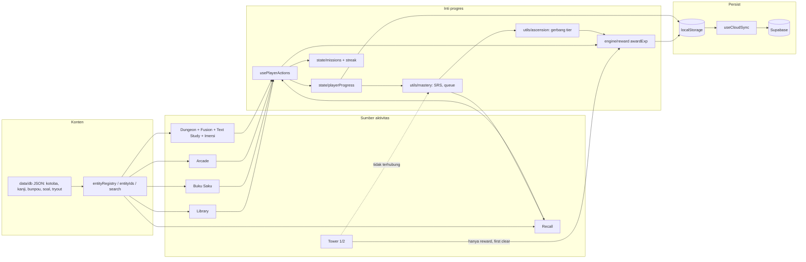

# Feature Dependency Map

## 1. Diagram modul

## 2. Matriks: fitur → apa yang ditulis
| Sumber aktivitas | EXP (ledger) | itemMastery/SRS | studyStats | Misi | Streak | Recall queue |
|---|---|---|---|---|---|---|
| Library (kuis kecil/detail) | ya | ya (attempt) | ya | ya | ya | ya |
| Library (menulis kanji/kosakata) | ya | ya (attempt writing) | ya | ya | ya | ya |
| Library (buka materi) | — | `viewCount` saja | — | — | — | tidak masuk |
| Buku Saku flashcard | ya | latihan (bukan attempt) | `flashcards` | kotoba/bunpou | ya | `NEW_UNTESTED` |
| Buku Saku menulis | ya | attempt 1/1 | ya | ya | ya | ya |
| Arcade | ya | attempt 1/1 (kanji/kotoba) | ya | ya | ya | ya |
| Dungeon | ya (agregat) | tidak (ID agregat) kecuali flashcard (latihan) | ya | ya | ya | sebagian |
| Tower 1/2 | ya (first clear) | **tidak** | **tidak** | tidak | ya (via reward) | **tidak** |
| Grammar Fusion | ya | tidak | tidak | tidak | ya | (Recall memakai engine Fusion) |
| Recall | ya | ya (7/7 atau 4/7) | tidak | kotoba/quiz | ya | — |
| Misi klaim | ya | — | — | — | tidak | — |

## 3. Ketergantungan keras (yang rusak bila diubah)
| Perubahan | Terdampak |
|---|---|
| Rumus level/tier (`data/rpg/tiers`) | `derivedState`, `useCloudSync`, `lib/supabase` (`getTierForExp`), SQL `nq_level_for_exp/nq_tier_for_exp`, leaderboard 707 baris |
| ID materi/alias (`entityIds`) | `canonicalizeStats`, deck, mastery, Recall, tes bunpou golden |
| Skema `ItemMasteryRecord` | `mastery.ts`, `cloudMerge`, `syncUserMasteryRelational` (mapping kolom), Recall, ascension |
| `PlayerStats` | `loadPlayerState`, `cloudMerge`, `useCloudSync`, `stripDerivedStats`, save lama pemain |
| `REWARD_POLICY` | ekonomi seluruh app; UI yang menampilkan "+X EXP" |
| Streak (`touchActiveDay`) | misi `wm_02`, Home, profil, leaderboard profil |
| `towerCloudState` | memuat sisa state Tower lama; hapus engine lama ⇒ ubah collect/apply |

## 4. Kopling berisiko
1. `usePlayerActions` ±400 baris memegang reward, misi, mastery, atribut, deck, reset — satu titik kegagalan; logika inti sudah dipindah ke fungsi murni (`playerProgress`, `missions`, `streak`, `awardExp`).
2. Callback bertingkat (`onRewardPlayer`/`onCompleteStudyItem`) diteruskan prop-drilling 4–6 level; tipe tersalin di banyak file (sebagian sudah `RewardHandler`).
3. `engine/index.ts` mengekspor `./tower` (mesin Tower lama) sehingga kode mati tetap terjangkau secara statis.
