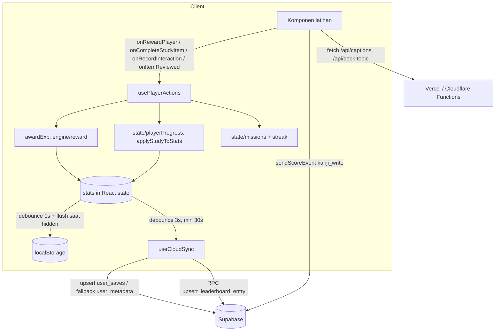

# System Overview

## 1. Tech stack ✅
| Lapisan | Pilihan | Catatan |
|---|---|---|
| UI | React 19.0, TypeScript ~5.8, Vite 6, Tailwind 4 (`@tailwindcss/vite`), `motion`, `lucide-react`, `canvas-confetti` | `package.json` bernama `react-example` |
| Input/Jepang | `wanakana` (IME romaji→kana), `hanzi-writer` + `hanzi-writer-data`, stroke JSON lokal (`public/data/kanji-strokes` 4.994 file, `kana-strokes` 486) | `JapaneseImeInput`, `KanjiWritingCanvas` (1.7k baris) |
| Backend | Supabase (`@supabase/supabase-js` 2.x): Auth (email/password + Google ID token), Postgres (RLS), RPC `SECURITY DEFINER` | Proxy same-origin `/supabase-proxy` (ISP Indonesia memblokir `*.supabase.co`) |
| Serverless | `api/captions.ts` (caption YouTube via endpoint internal tak resmi), `api/deck-topic.ts` (LLM opsional, rate-limit 10/menit/IP in-memory) | Salinan Cloudflare Pages Functions di `functions/` |
| PWA | `public/sw.js` (cache `sevnquest-v2.7`), `manifest.webmanifest`, `PwaInstallModal` | HTML network-first; aset statis cache-first; `/api/*`, Supabase, Google: network-only |
| Tes | `tsx --test` (Node 22 `node:test`) — 22 file, 205 tes | tanpa CI |
| Deploy | Vercel (`vercel.json`) **dan** Cloudflare Pages (`functions/`, `public/_headers`; PR preview Cloudflare terdeteksi) | dua target deploy dipelihara paralel |

Dependensi yang tampak tak dipakai runtime 🔶: `express`, `dotenv`, `jimp`, `esbuild`, `gh-pages` (perlu `grep` impor untuk memastikan). `.env.example` menyebut `server/engineServer.ts` & `scripts/ai_consultant.mjs` yang **tidak ada** di repo ✅.

## 2. Struktur folder ✅
```
index.html, vite.config.ts, vercel.json, tsconfig.json
api/                 Vercel serverless (captions, deck-topic) + tes captions
functions/           Cloudflare Pages Functions (captions, deck-topic, supabase-proxy)
public/              sw.js, manifest, _headers, ikon, data/{kanji,kana}-strokes, avatars
scripts/jmdict/      skrip Python pembangun kosakata dari JMdict (atribusi EDRDG, CC BY-SA 4.0)
supabase/migrations/ (baru) usulan user_saves — BELUM diterapkan
docs/                dokumen audit
src/
  main.tsx           boot: BootSplash → lazy import App (+ retry), visitors ping 4 dtk kemudian
  App.tsx            4 state inti + hooks; header, MainContent, modal status, nav bawah, onboarding
  app/MainContent.tsx  overlay Recall + 7 tab keep-alive (lazy: World, Settings, Recall, Library, BukuSaku, Leaderboard)
  hooks/             usePlayerActions (pusat aksi), useCloudSync, usePersistence, useDailyRollover,
                     useAppNavigation, useBackButton, useStudyTimeTracker, useToast, useTheme, useSavedWords
  state/             loadPlayerState, defaultStats, derivedState, canonicalizeStats, playerProgress (murni),
                     missions (murni), streak (murni), storageKeys
  engine/            reward/ (baru), recall/, fusion/, tower1/, tower/ (lama, sebagian mati), search/, registry/,
                     traits/, morphology/ (conjugator), syntax/, synthesis/, practice/, deck/, textStudy/
  components/        arcade, auth, avatar, common, deck, dungeon(+fusion), home, layout, leaderboard, learning,
                     library, map, missions, modals, pwa, settings, tower1, tutorial, ui
  data/              konten (db/*.json ±400k baris JSON), tryouts, world (mati), tower1/tower2, rpg (tiers, missions), fusion
  utils/             rewards, mastery, ascension, activity, cloudMerge, decks, recovery, time, audio, furigana, dll.
  lib/               supabase.ts (semua akses backend), googleIdentity.ts, visitors.ts
  types/             rpg.ts, content.ts, identity.ts, tower.ts, books.ts
```
Ukuran: ±270 file kode `.ts/.tsx` (±83k baris setelah penghapusan ±7k baris UI mati) + dataset JSON ±1,0 juta baris.

## 3. Arsitektur & alur data utama

- **Satu sumber state**: `stats` (PlayerStats) + `stageProgress` (mati) + `dailyMissions` + `weeklyMissions` di `App.tsx`; ref terbaru (`statsRef` dst.) untuk efek async.
- **Turunan tidak disimpan**: `recallQueue` dihitung ulang dari `itemMastery` (`stripDerivedStats`).
- **Identitas materi kanonik**: `data/entityIds.ts` + `state/canonicalizeStats.ts` menggabung alias lama (`bunpou_001`→`w1d1g1`) dan kanji-by-karakter.
- **Tab keep-alive** (`FreezeWhenHidden`): tab yang sudah dikunjungi tetap ter-mount (navigasi instan), tapi dibekukan saat tersembunyi.
- **Offline**: PWA menyimpan aset statis; konten dibundel di JS (chunk besar) sehingga banyak fitur jalan offline; Supabase tidak di-cache.

## 4. Boot, auth & sinkron ✅
1. `main.tsx` render `BootSplash`, lalu `import('./App.tsx')` (retry bila gagal).
2. `loadInitialStats()` → parse localStorage → canonicalize → `applyLevelFromExp`.
3. `useCloudSync`: `getSession` + `onAuthStateChange`; sekali per user `handleCloudSync` (retry 1× setelah 2 dtk), gerbang `cloudHydrated` mencegah autosave menimpa cloud sebelum rekonsiliasi.
4. Tamu (tanpa login) tetap bermain penuh secara lokal; leaderboard/skor mingguan hanya untuk yang login.

## 5. Deployment & konfigurasi
| Env | Dipakai di | Fungsi | Status |
|---|---|---|---|
| `VITE_SUPABASE_URL`, `VITE_SUPABASE_ANON_KEY` | klien | override default yang di-hardcode di `lib/supabase.ts` | opsional; anon key publik by design |
| `VITE_SECURE_LEADERBOARD` | klien | `'false'` = jalur lama (kini default true) | default berubah di PR ini |
| `VITE_GOOGLE_AUTH`, `VITE_GOOGLE_CLIENT_ID` | klien | tombol Google | opsional |
| `DECK_AI_BASE_URL/API_KEY/MODEL` | serverless | LLM deck | opsional → 503 → klien fallback lokal |
| `SUPABASE_URL` | CF function | target proxy | opsional |
| `ENX_*`, `PORT` | — | disebut `.env.example`, kode pendukung tidak ada | usang |

Header keamanan: `X-Content-Type-Options`, `Referrer-Policy`, `X-Frame-Options: SAMEORIGIN`, HSTS (Vercel & `_headers`). **Tidak ada CSP** ✅.

## 6. Ukuran bundel (vite build) ✅
Chunk data terbesar (tak terkompresi): `data-kotoba` **8,5 MB**, `data-kanji-questions` 3,5 MB, `data-tryouts` 2,4 MB, `data-bunpou-questions` 1,3 MB, `data-kanji-extreme-100-stages` 1,2 MB, `data-bunpou` 1,1 MB, `data-kanji` 0,9 MB, `WorldView` 0,5 MB. Vendor: supabase 214 kB, react 194 kB, motion 129 kB. `dist/` total 49 MB (stroke JSON + avatar). Dimuat lazy per modul; kotoba 8,5 MB adalah beban terbesar pada koneksi lambat 🔶.
