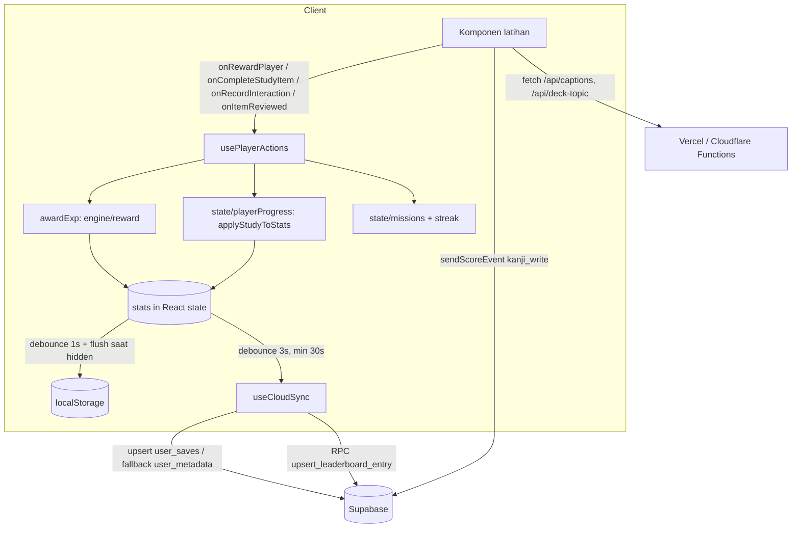

# System Overview

## 1. Tech stack ✅
| Lapisan | Pilihan | Catatan |
|---|---|---|
| UI | React 19.0, TypeScript ~5.8, Vite 6, Tailwind 4 (`@tailwindcss/vite`), `motion`, `lucide-react`, `canvas-confetti` | `package.json` bernama `react-example` |
| Input/Jepang | `wanakana` (IME romaji→kana), `hanzi-writer` + `hanzi-writer-data`, stroke JSON lokal (`public/data/kanji-strokes` 4.994 file, `kana-strokes` 486) | `JapaneseImeInput`, `KanjiWritingCanvas` (1.7k baris) |
| Backend | Supabase (`@supabase/supabase-js` 2.x): Auth (email/password + Google ID token), Postgres (RLS), RPC `SECURITY DEFINER` | Proxy same-origin `/supabase-proxy` (ISP Indonesia memblokir `*.supabase.co`) |
| Serverless | `api/captions.ts` (caption YouTube via endpoint internal tak resmi), `api/deck-topic.ts` (LLM opsional, rate-limit 10/menit/IP in-memory) | Salinan Cloudflare Pages Functions di `functions/` |
| PWA | `public/sw.js` (cache `sevnquest-v2.7`), `manifest.webmanifest`, `PwaInstallModal` | HTML network-first; aset statis cache-first; `/api/*`, Supabase, Google: network-only |
| Tes | `tsx --test` (Node 22 `node:test`) — 22 file, 205 tes | tanpa CI |
| Deploy | Vercel (`vercel.json`) **dan** Cloudflare Pages (`functions/`, `public/_headers`; PR preview Cloudflare terdeteksi) | dua target deploy dipelihara paralel |

Dependensi yang tampak tak dipakai runtime 🔶: `express`, `dotenv`, `jimp`, `esbuild`, `gh-pages` (perlu `grep` impor untuk memastikan). `.env.example` menyebut `server/engineServer.ts` & `scripts/ai_consultant.mjs` yang **tidak ada** di repo ✅.

## 2. Struktur folder ✅
```
index.html, vite.config.ts, vercel.json, tsconfig.json
api/                 Vercel serverless (captions, deck-topic) + tes captions
functions/           Cloudflare Pages Functions (captions, deck-topic, supabase-proxy)
public/              sw.js, manifest, _headers, ikon, data/{kanji,kana}-strokes, avatars
scripts/jmdict/      skrip Python pembangun kosakata dari JMdict (atribusi EDRDG, CC BY-SA 4.0)
supabase/migrations/ (baru) usulan user_saves — BELUM diterapkan
docs/                dokumen audit
src/
  main.tsx           boot: BootSplash → lazy import App (+ retry), visitors ping 4 dtk kemudian
  App.tsx            4 state inti + hooks; header, MainContent, modal status, nav bawah, onboarding
  app/MainContent.tsx  overlay Recall + 7 tab keep-alive (lazy: World, Settings, Recall, Library, BukuSaku, Leaderboard)
  hooks/             usePlayerActions (pusat aksi), useCloudSync, usePersistence, useDailyRollover,
                     useAppNavigation, useBackButton, useStudyTimeTracker, useToast, useTheme, useSavedWords
  state/             loadPlayerState, defaultStats, derivedState, canonicalizeStats, playerProgress (murni),
                     missions (murni), streak (murni), storageKeys
  engine/            reward/ (baru), recall/, fusion/, tower1/, tower/ (lama, sebagian mati), search/, registry/,
                     traits/, morphology/ (conjugator), syntax/, synthesis/, practice/, deck/, textStudy/
  components/        arcade, auth, avatar, common, deck, dungeon(+fusion), home, layout, leaderboard, learning,
                     library, map, missions, modals, pwa, settings, tower1, tutorial, ui
  data/              konten (db/*.json ±400k baris JSON), tryouts, world (mati), tower1/tower2, rpg (tiers, missions), fusion
  utils/             rewards, mastery, ascension, activity, cloudMerge, decks, recovery, time, audio, furigana, dll.
  lib/               supabase.ts (semua akses backend), googleIdentity.ts, visitors.ts
  types/             rpg.ts, content.ts, identity.ts, tower.ts, books.ts
```
Ukuran: ±270 file kode `.ts/.tsx` (±83k baris setelah penghapusan ±7k baris UI mati) + dataset JSON ±1,0 juta baris.

## 3. Arsitektur & alur data utama

- **Satu sumber state**: `stats` (PlayerStats) + `stageProgress` (mati) + `dailyMissions` + `weeklyMissions` di `App.tsx`; ref terbaru (`statsRef` dst.) untuk efek async.
- **Turunan tidak disimpan**: `recallQueue` dihitung ulang dari `itemMastery` (`stripDerivedStats`).
- **Identitas materi kanonik**: `data/entityIds.ts` + `state/canonicalizeStats.ts` menggabung alias lama (`bunpou_001`→`w1d1g1`) dan kanji-by-karakter.
- **Tab keep-alive** (`FreezeWhenHidden`): tab yang sudah dikunjungi tetap ter-mount (navigasi instan), tapi dibekukan saat tersembunyi.
- **Offline**: PWA menyimpan aset statis (chunk JS + dataset `.json` di `/assets/`, cache-first) sehingga fitur yang pernah dibuka jalan offline; Supabase tidak di-cache.

## 4. Boot, auth & sinkron ✅
1. `main.tsx` render `BootSplash`, lalu `import('./App.tsx')` (retry bila gagal; muat ulang halaman bila dataset gagal diunduh). Dataset inti (kotoba INTI, kanji, bunpou, dokkai) di-preload dari `index.html` dan di-await modul datanya (top-level await).
2. `loadInitialStats()` → parse localStorage → canonicalize → `applyLevelFromExp`.
3. `useCloudSync`: `getSession` + `onAuthStateChange`; sekali per user `handleCloudSync` (retry 1× setelah 2 dtk), gerbang `cloudHydrated` mencegah autosave menimpa cloud sebelum rekonsiliasi.
4. Tamu (tanpa login) tetap bermain penuh secara lokal; leaderboard/skor mingguan hanya untuk yang login.
5. Setelah tampil (idle, ≤1,5 dtk) `useFullData` memuat data lengkap (`data/fullData.ts`: detail kotoba, bank soal kanji & bunpou), menggabungkannya ke objek basis data yang sama, lalu membangun ulang antrean Recall. Setiap komponen `lazyWithRetry` menunggu `ensureFullData()`, jadi layar lazy selalu melihat data lengkap; kode jalur boot hanya boleh membaca field inti (dijaga `data/fullData.test.ts`).

## 5. Deployment & konfigurasi
| Env | Dipakai di | Fungsi | Status |
|---|---|---|---|
| `VITE_SUPABASE_URL`, `VITE_SUPABASE_ANON_KEY` | klien | override default yang di-hardcode di `lib/supabase.ts` | opsional; anon key publik by design |
| `VITE_SECURE_LEADERBOARD` | klien | `'false'` = jalur lama (kini default true) | default berubah di PR ini |
| `VITE_GOOGLE_AUTH`, `VITE_GOOGLE_CLIENT_ID` | klien | tombol Google | opsional |
| `DECK_AI_BASE_URL/API_KEY/MODEL` | serverless | LLM deck | opsional → 503 → klien fallback lokal |
| `TTS_GOOGLE_API_KEY`, `TTS_VOICE_FEMALE/MALE` | serverless (`api/tts`) | suara Jepang neural (Google Cloud TTS) | opsional → 503 → klien memakai suara perangkat |
| `SUPABASE_URL` | CF function | target proxy | opsional |

Header keamanan: `X-Content-Type-Options`, `Referrer-Policy`, `X-Frame-Options: SAMEORIGIN`, HSTS (Vercel & `_headers`). **Tidak ada CSP** ✅.

## 6. Ukuran bundel & pemuatan data ✅
Dataset `src/data/db/*.json` ≥ 64 KB tidak lagi menjadi literal di dalam chunk JS. Plugin `sevn-datasets` (`vite.config.ts`) mengirimnya sebagai `assets/<nama>-<hash>.json` dengan modul pengganti `export default await loadDataset(url)` — konsumen tetap memakai impor sinkron, teks JSON dibuang setelah di-parse (literal di skrip menetap di memori), dan dataset jalur boot di-preload dari `index.html`. `kotoba.json` dipecah saat build: INTI (field jalur boot, `data/kotobaSplit.ts`) dan DETAIL (contoh kalimat, kolokasi, definisi) yang digabung in place oleh `data/kotobaDetails.ts`. Saat dev dataset tetap inline; tes (tsx) memakai JSON utuh.

| Jalur | Sebelum | Sesudah |
|---|---|---|
| JS yang dimuat sebelum App tampil (tak terkompresi) | 17,2 MB | 1,0 MB + 6,7 MB JSON inti |
| Boot dingin, Chromium CPU 4×, 10 Mbps | 5,3 dtk | 2,9 dtk |
| Boot dingin, Chromium CPU 4×, jaringan lokal | 2,1 dtk | 1,8 dtk |
| Heap JS setelah GC (data lengkap termuat) | 42 MB | 28 MB |

Dataset terbesar (tak terkompresi): `kotoba-detail` 5,1 MB, `kotoba` (inti) 4,5 MB, `kanji-questions` 3,6 MB, `data-tryouts` (JS) 2,4 MB, `bunpou-questions` 1,3 MB, `kanji-extreme-100-stages` 1,2 MB, `bunpou` 1,1 MB, `kanji` 1,0 MB. Vendor: supabase 214 kB, react 194 kB, motion 129 kB. Build menargetkan es2022 / Safari 15+ (top-level await; aplikasi sudah mensyaratkan Safari 16.4+). `dist/` ±50 MB (sebagian besar stroke JSON di `public/data`).

## 7. Suara Jepang (TTS) & furigana ✅
- **Teks ucapan = teks tampilan.** `utils/speechText.ts` menurunkan ucapan dari segmentasi furigana yang sama dengan `RubyText` (`alignFurigana`), membuang romaji/terjemahan dalam kurung, 〜, kotak isian, dan instruksi berbahasa Indonesia. Saat build, `scripts/speech/speechHints.ts` (kuromoji) menandai pasangan data yang kanjinya berisiko dibaca lain oleh mesin TTS (±9%); hanya unit itu yang diucapkan dengan kana furigana, sisanya tetap kanji agar intonasi alami.
- **Mesin suara** `utils/speech.ts`: Web Speech dengan peringkat suara (Natural/Neural > Google > Apple Enhanced > lainnya), aman untuk iOS (speak sinkron dalam ketukan), teks panjang dipecah, watchdog `onend`, dialog choukai per pembicara (pria/wanita), dan toast panduan bila perangkat tidak punya suara Jepang. Opsional suara cloud neural lewat `/api/tts` (lihat tabel env).
- **Furigana** `utils/furiganaUtils.ts`: penyelarasan teks ↔ bacaan memakai pemrograman dinamis (angka, huruf Latin, 〇, ヶ, bacaan beranotasi per kata, bentuk alternatif). Gerbang data `data/readings.quality.test.ts` memastikan setiap bacaan data selaras dengan tulisannya.

