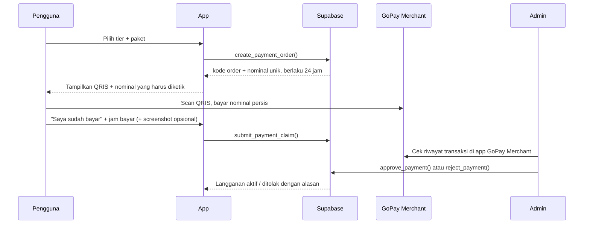

# PRD: Model Monetisasi SevnQuest / Nihongo Quest

Versi: 0.5 (fase 1 diimplementasikan)
Tanggal: 4 November 2026
Status: Draft untuk review

---

## 0. Perubahan dari versi 0.1

| # | Versi 0.1 | Versi 0.2 | Alasan |
|---|---|---|---|
| 1 | Gateway Midtrans/Xendit, langganan otomatis, webhook | **QRIS statis GoPay Merchant**, bayar per periode, verifikasi manual oleh admin | QRIS yang tersedia adalah QRIS statis. QRIS statis tidak mengirim webhook dan tidak bisa menagih otomatis tiap bulan. |
| 2 | Konten: Map 1 Stage 1–5, 132 pola, 924 soal (data N3 GATE) | Konten mengikuti isi repo ini: N5–N1, Tower 100 lantai, Library, Recall, Arcade, Dungeon | Angka di 0.1 berasal dari N3 GATE, bukan dari repo `sevnquest`. Peta stage tidak ada di repo ini. |
| 3 | 10 level = 10 rank leaderboard (Minarai → Kami), donatur = rank 4–10 | Level donatur punya badge sendiri, **tidak** memakai rank belajar | Repo memakai 10 tier RPG berbasis EXP (Villager → Mythic Deity). Memakai rank yang sama untuk donatur bertentangan dengan aturan "donasi bukan pay-to-win". |
| 4 | Kuota Kaiwa AI (Gemini) per tier | Kaiwa dikeluarkan dari tier. Fitur AI yang ada: **Deck AI** | Tidak ada fitur Kaiwa maupun integrasi Gemini di repo ini. |
| 5 | "Akses dicek di Edge Function, data diverifikasi di backend" | Gating dua jenis: **lunak** (konten yang dibundel di klien) dan **keras** (fitur server) | Konten dibundel di JS dan bisa dipakai offline; tamu bisa bermain penuh tanpa login. Konten tidak bisa dikunci di backend tanpa memindahkan data ke server. |
| 6 | Tidak menyebut kanal donasi yang sudah ada | Trakteer (`teer.id/sevnsoul`) di Pengaturan **diganti QRIS** | Keputusan pemilik (v0.3). Semua pembayaran lewat satu kanal. |
| 7 | Basic = Map 1 Stage 1–5 | Basic = **kana (hiragana, katakana) sampai N5** | Keputusan pemilik (v0.3). |
| 8 | Produk N3 GATE / NihongoQuest belum jelas | Produk utama adalah **SevnQuest**, mencakup seluruh bahasa Jepang (kana sampai N1, plus Kaigo dan SSW) | Keputusan pemilik (v0.3). |
| 9 | Donatur hanya bulanan | + **Lifetime Rp 700.000** sekali bayar: akses Full selamanya + title permanen. Title bulanan D1–D7 tetap ada | Keputusan pemilik (v0.4). |
| 10 | Tamu bisa bermain penuh tanpa login | **Wajib login** untuk semua pengguna, termasuk Basic | Keputusan pemilik (v0.4). |
| 11 | Verifikasi otomatis lewat webhook | Fase 1 manual oleh pemilik tiap malam dengan halaman admin; fase 2 gateway QRIS dinamis bila volume naik | Keputusan pemilik (v0.4), lihat 6.3. |

---

## 1. Ringkasan

SevnQuest adalah produk utama: web app belajar bahasa Jepang yang mencakup seluruh jenjang, dari kana sampai JLPT N1, plus kosakata Kaigo dan SSW. PRD ini berlaku untuk SevnQuest. Dua lapisan monetisasi:

1. **Tier Akses (3 level):** Basic, Medium, Full. Menentukan konten dan fitur yang bisa dipakai.
2. **Tier Donatur:** title bulanan D1–D7 (dibayar di atas tier akses) dan paket **Lifetime** sekali bayar. Benefitnya kosmetik dan komunitas, terpisah dari rank belajar.

Pembayaran memakai QRIS statis milik merchant:

| Data | Nilai |
|---|---|
| Penyedia | GoPay Merchant (QRIS, diterima semua e-wallet dan m-banking) |
| Nama merchant | SEVNSOUL STORE, DIGITAL & KREATIF |
| NMID | ID1026625677186 |
| Terminal | A01 |

Tujuan:
- Ada pemasukan rutin untuk menutup biaya Supabase, API LLM (Deck AI), dan pengembangan konten.
- Pengguna gratis tetap mendapat pengalaman belajar yang utuh di level awal.
- Donasi terasa sebagai dukungan, bukan membeli kemenangan di papan skor belajar.

---

## 2. Kondisi Produk Saat Ini (repo `sevnquest`)

Sumber: `docs/audit/FEATURE_INVENTORY.md` dan `docs/audit/SYSTEM_OVERVIEW.md`.

| Komponen | Isi | Status |
|---|---|---|
| Kotoba | 18.353 entri (N5 700, N4 731, N3 1.960, N2 3.333, N1 11.369, Kaigo 229, SSW 31) | Aktif |
| Kanji | 2.507 entri (N5 80, N4 167, N3 366, N2 378, N1 1.373, kana 143) | Aktif |
| Bunpou | 915 pola (N5 119, N4 189, N3 132, N2 208, N1 267) | Aktif |
| Bank soal | kanji_questions 7.754, bunpou_questions 2.525 | Aktif |
| Tryout | 27 resmi + 10 dalam-app | Aktif |
| Tower | 100 lantai (Menara 1: 001–016, Menara 2: 017–100) | Aktif |
| Recall (SRS) | 40 jawaban/hari, 10 materi baru/hari, Latihan Ekstra tanpa batas | Aktif |
| Arcade (5 mode), Dungeon (11 jenis) | | Aktif |
| Deck AI | LLM memperluas kata kunci; tanpa env jatuh ke pencocokan lokal | Aktif, opsional |
| Imersi YouTube | Caption lewat endpoint tak resmi, bisa diblokir | Aktif, rapuh |
| Choukai | `CHOUKAI_ENABLED=false` | **Nonaktif** (masalah audio) |
| Leaderboard | All-time dan mingguan, hanya untuk pengguna login | Aktif |

Fakta arsitektur yang berdampak ke monetisasi:
- Konten dibundel di JS dan disimpan PWA, sehingga bisa dipakai offline.
- Saat ini tamu (tanpa login) bermain penuh secara lokal. Mulai monetisasi, **semua pengguna wajib login** (lihat 6.4).
- Backend: Supabase (Auth, Postgres + RLS, RPC `SECURITY DEFINER`) dan Cloudflare Pages Functions (`functions/`). Tidak ada Supabase Edge Function.
- Supabase diakses lewat proxy `/supabase-proxy` karena beberapa ISP memblokir `*.supabase.co`.

**Implikasi:** Tier berbayar tidak boleh menjanjikan konten yang belum ada. Choukai baru masuk tier setelah diaktifkan kembali dan lolos uji.

---

## 3. Tujuan & Non-Tujuan

### Tujuan
- Pengguna baru bisa mencoba produk secara gratis tanpa batas waktu.
- Harga berbayar terjangkau untuk pelajar Indonesia (mulai Rp 15.000/bulan).
- Struktur tier mudah dipahami dalam satu layar.
- Papan donatur terpisah dari papan skor belajar.
- Pembayaran aktif paling lambat 24 jam walau verifikasi manual (diproses tiap malam).

### Non-Tujuan (versi ini)
- Tidak membuat sistem afiliasi atau referral.
- Tidak ada iklan di dalam app.
- Tidak ada perpanjangan otomatis (auto-debit).
- Tidak ada payment gateway berbayar. Bisa ditambah nanti bila volume transaksi membuat verifikasi manual tidak sanggup.
- Tidak memindahkan konten ke server untuk penguncian keras (lihat 6.4).

---

## 4. Tier Akses

Pembagian berdasarkan keputusan pemilik (v0.3): kana sampai N5 gratis.

| Tier | Harga | Konten | Fitur |
|---|---|---|---|
| **Basic** | Gratis | Kana (hiragana, katakana) dan semua materi N5: kotoba, kanji, bunpou, soal. Tower lantai yang materinya kana atau N5 (Menara 1: 001–016, lalu lantai N5 di Menara 2). Tryout N5 | Recall dengan batas harian saat ini (40 jawaban, 10 materi baru), Arcade dan Dungeon dengan sumber materi kana/N5, leaderboard, cloud sync |
| **Medium** | Rp 15.000 / bulan | + Materi N4 dan N3 (bunpou 189 + 132 pola, kanji 167 + 366, kotoba 731 + 1.960), Tower lantai N4 dan N3, tryout N4–N3 | + Latihan Ekstra Recall tanpa batas, semua mode Dungeon, statistik lengkap |
| **Full** | Rp 35.000 / bulan | + Materi N2 dan N1, Kaigo dan SSW, semua tryout, Choukai saat aktif kembali | + Deck AI, Imersi YouTube, early access fitur baru |

Aturan pembagian: tier sebuah materi ditentukan oleh level JLPT-nya. Kana dan N5 = Basic, N4–N3 = Medium, N2–N1 serta Kaigo/SSW = Full. Untuk Tower, Arcade, Dungeon, dan Buku Saku, yang dicek adalah level materi yang dipakai, bukan modenya. Tower: lantai 001–060 (kana dan N5) = Basic, 061–100 (N4) = Medium. JFT-Basic dihitung setara N4 (Medium). Materi campuran yang memuat level berbayar (misal "Semua Level", "N5–N4") mengikuti level tertingginya. Paket Basic mendapat 1 putaran Latihan Ekstra Recall per hari.

Paket periode (QRIS statis tidak bisa menagih otomatis, jadi pengguna membeli masa aktif di muka):

| Paket | Medium | Full |
|---|---|---|
| 1 bulan | Rp 15.000 | Rp 35.000 |
| 3 bulan | Rp 42.000 | Rp 99.000 |
| 12 bulan | Rp 150.000 | Rp 350.000 |

Catatan:
- Pembelian baru saat masih aktif **menambah** masa aktif, tidak menimpa.
- Naik dari Medium ke Full saat masih aktif: Full langsung aktif sejak disetujui; sisa Medium tidak hilang dan tetap berlaku setelah Full berakhir (lebih sederhana daripada konversi proporsional dan tidak merugikan pengguna).
- Pengguna yang sudah memakai materi tier atas sebelum monetisasi berlaku tetap menyimpan progresnya. Materi itu hanya terkunci untuk latihan baru.

---

## 5. Tier Donatur

Tier donatur adalah pembayaran tambahan di atas tier akses. Pengguna harus punya tier Medium atau Full yang aktif untuk ikut donatur.

| Level | Nama badge (usulan) | Harga / bulan | Benefit |
|---|---|---|---|
| D1 | Sakura | Rp 25.000 | Badge donatur, nama di papan donatur |
| D2 | Ume | Rp 50.000 | + Frame avatar khusus |
| D3 | Take | Rp 75.000 | + Voting topik konten berikutnya |
| D4 | Matsu | Rp 100.000 | + Nama tampil di halaman utama |
| D5 | Tsuki | Rp 150.000 | + Prioritas antrian request konten |
| D6 | Taiyou | Rp 250.000 | + Sesi feedback 1-on-1 (per bulan) |
| D7 | Fuji | Rp 500.000 | + Semua benefit sebelumnya + nama di kredit app |

Nama badge hanya contoh dan tidak memakai nama tier RPG (Villager … Mythic Deity) maupun rank leaderboard.

### Paket Lifetime

| Paket | Harga | Benefit |
|---|---|---|
| **Lifetime** | Rp 700.000 sekali bayar | Akses **Full selamanya**, title permanen (usulan nama: *Eien*), nama di papan donatur bagian Lifetime |

- Title permanen tidak pernah hilang. Title bulanan D1–D7 tetap bisa dibeli di atasnya; pengguna Lifetime tidak perlu tier akses terpisah untuk ikut donatur bulanan.
- Pengguna yang sedang berlangganan Medium/Full lalu membeli Lifetime: sisa masa aktif tidak dikembalikan dalam bentuk uang.
- "Selamanya" berarti selama SevnQuest beroperasi. Ini ditulis jelas di halaman pembelian dan syarat layanan.
- Fitur yang memakan biaya per pemakaian (Deck AI) tetap mengikuti batas wajar harian yang sama dengan Full (30 permintaan per hari WIB, dihitung di database), supaya biaya LLM tidak tak terbatas untuk pembayaran sekali.
- Titik impas: Rp 700.000 setara 20 bulan Full. Harga ditinjau ulang bila biaya server per pengguna naik.

### Aturan "prioritas"
- Prioritas berarti **urutan antrian request konten dan voting**, bukan posisi di papan skor belajar.
- Papan skor belajar (EXP, skor mingguan) tetap murni berdasarkan performa.
- Tier RPG tetap hanya dari EXP dan gerbang ascension. Donasi tidak memberi EXP, gold, atau bonus apa pun yang memengaruhi skor.
- Papan donatur tampil terpisah dan menampilkan Lifetime serta level D1–D7 beserta nama.

### Papan donatur
- Tampil **hanya di dalam app** (perlu login), tidak di halaman publik atau yang bisa diindeks mesin pencari.
- Nama yang tampil adalah nama tampilan (display name) di app, bukan nama asli atau email.
- Donatur bisa memilih **anonim**; level dan title tetap terhitung, namanya tampil sebagai "Donatur anonim".
- Alasan: tidak semua orang ingin jumlah donasinya terlihat publik, dan papan di dalam app tetap jadi motivasi bagi pengguna lain. Bila nanti dibutuhkan untuk promosi, halaman publik bisa ditambah dengan izin terpisah (opt-in).

### Pengganti Trakteer
Tombol "Dukung Developer" (Trakteer, `teer.id/sevnsoul`) di Pengaturan diganti dengan halaman Dukung/Upgrade yang memakai QRIS. Donasi sekali bayar tanpa benefit tetap bisa: pengguna memindai QRIS dan membayar nominal bebas tanpa membuat order. Donasi seperti itu tidak memberi badge karena tidak bisa dicocokkan ke akun.

---

## 6. Fitur Teknis

### 6.1 Alur pembayaran (QRIS statis + verifikasi manual)

Detail:
- **Nominal unik.** QRIS statis tidak membawa ID pesanan, jadi transaksi dicocokkan lewat nominal. Harga dikurangi kode unik 1–99 (contoh Medium 1 bulan: Rp 14.937). Pengguna tidak pernah membayar di atas harga daftar. Kode unik tidak boleh sama di antara order `pending` dengan harga dasar yang sama. Bila 99 kode habis, pakai 3 digit.
- **Masa berlaku order:** 24 jam. Setelah itu status `expired` dan kode unik dilepas.
- **Klaim:** pengguna mengisi jam bayar dan boleh mengunggah screenshot. Screenshot hanya bukti pendukung. Admin wajib mencocokkan ke riwayat transaksi GoPay Merchant karena screenshot mudah dipalsukan.
- **Nominal tidak cocok** (salah ketik): admin bisa menyetujui manual bila jumlah ≥ harga paket dikurangi kode unik dan transaksinya bisa diidentifikasi. Bila kurang, ditolak dan diarahkan ke kontak dukungan.
- **Bayar tanpa klaim:** transaksi yang cocok dengan order `pending` boleh disetujui admin tanpa menunggu klaim.
- **Notifikasi:** status order tampil di app. Notifikasi email opsional (fase 2).

Opsi fase 2: membuat QRIS dengan nominal terisi otomatis dari payload QRIS statis (tag 54, point of initiation 12, hitung ulang CRC). Ini mengurangi salah ketik nominal, tetapi tetap tidak memberi verifikasi otomatis. Wajib diuji di beberapa e-wallet dan bank, dan dicek terhadap ketentuan GoPay Merchant sebelum dipakai.

### 6.2 Data

Tabel baru di Supabase (semua dengan RLS):

| Tabel | Kolom utama | Akses |
|---|---|---|
| `subscription_tiers` | `tier_code`, `type` (access / donor), `level`, `price_idr`, `benefits` (JSON), `active` | Baca: semua. Tulis: admin |
| `payment_orders` | `id`, `order_code`, `user_id`, `tier_code`, `period_months`, `base_price_idr`, `unique_code`, `amount_idr`, `status` (pending / claimed / paid / rejected / expired), `paid_at_reported`, `proof_path`, `reject_reason`, `verified_by`, `verified_at`, `created_at`, `expires_at` | Pengguna: baca baris sendiri. Buat dan klaim hanya lewat RPC |
| `user_subscriptions` | `user_id`, `tier_code`, `starts_at`, `expires_at`, `source_order_id` | Pengguna: baca baris sendiri. Tulis: hanya lewat `approve_payment` |
| `admins` | `user_id` | Tidak bisa dibaca klien |

RPC (`SECURITY DEFINER`, mengikuti pola `upsert_leaderboard_entry`):
- `create_payment_order(tier_code, period_months)`: hitung nominal unik, batasi maksimal 3 order `pending` per pengguna.
- `submit_payment_claim(order_id, paid_at, proof_path)`.
- `approve_payment(order_id)` dan `reject_payment(order_id, reason)`: cek pengguna ada di `admins`. Approve menambah atau memperpanjang `user_subscriptions` dalam satu transaksi.
- `get_my_entitlement()`: kembalikan tier akses, tier donatur, dan tanggal kedaluwarsa.

Lifetime disimpan sebagai baris `user_subscriptions` dengan `tier_code = 'lifetime'` dan `expires_at = null` (tidak pernah kedaluwarsa); entitlement-nya setara Full. Title permanen disimpan di kolom `benefits` tier tersebut.

Bukti bayar disimpan di bucket Storage privat `payment-proofs`, path `<user_id>/<order_id>.jpg`. Pengguna hanya bisa unggah ke foldernya sendiri. Hanya admin yang bisa membaca semua.

### 6.3 Admin dan verifikasi

**Fase 1: manual oleh pemilik, tiap malam.**
- Halaman admin di app (hanya untuk akun di tabel `admins`): daftar order `claimed` dan `pending` diurutkan menurut nominal, jam bayar, screenshot, tombol setujui/tolak, dan setujui massal.
- Pemilik membuka riwayat transaksi di app GoPay Merchant di sebelahnya. Karena tiap order punya nominal unik, satu order cukup dicocokkan dengan melihat nominal dan jam. Perkiraan 20–30 detik per order.
- Order yang masuk setelah verifikasi malam diproses malam berikutnya, jadi waktu tunggu terlama sekitar 24 jam. Halaman Upgrade menyebut ini dengan jelas ("diaktifkan paling lambat 1×24 jam").
- Semua keputusan admin tercatat (`verified_by`, `verified_at`, `reject_reason`).
- Kapasitas wajar: sampai sekitar 30–50 order per malam (15–25 menit).

**Fase 2: otomatis lewat payment gateway.**
- QRIS statis tidak bisa diverifikasi otomatis secara andal. GoPay Merchant tidak menyediakan API riwayat transaksi untuk QRIS statis, dan membaca notifikasi HP dengan aplikasi pihak ketiga itu rapuh dan berisiko melanggar ketentuan.
- Untuk ratusan sampai ribuan pembeli, pakai gateway yang membuat **QRIS dinamis per order** dan mengirim webhook (contoh: Midtrans, Xendit, Duitku, Tripay). Langganan aktif dalam hitungan detik tanpa campur tangan admin. Biaya QRIS di gateway umumnya sekitar 0,7% per transaksi (cek harga terbaru saat memilih).
- Pemicu pindah ke fase 2: lebih dari 30 order per malam selama 2 minggu berturut-turut, atau keluhan waktu tunggu meningkat.
- Tabel `payment_orders` dan `user_subscriptions` dirancang sama untuk kedua fase, jadi pindah ke gateway hanya menambah sumber konfirmasi (webhook) tanpa mengubah logika langganan.

### 6.4 Gating

| Jenis | Berlaku untuk | Cara | Keamanan |
|---|---|---|---|
| **Lunak** | Konten yang dibundel di klien (materi N3–N1, Tower, Dungeon, tryout) | Klien membaca `get_my_entitlement()` saat login, menyimpan hasilnya di cache lokal, menampilkan kunci dan CTA upgrade | Bisa diakali oleh pengguna teknis. Diterima untuk v1. |
| **Keras** | Fitur server: Deck AI (`functions/api/deck-topic.ts`), Imersi (`functions/api/captions.ts`) | Cloudflare Function memverifikasi JWT Supabase dan memanggil `get_my_entitlement` sebelum memanggil LLM atau caption | Tidak bisa diakali dari klien |

- Tag `tier_required` diturunkan dari level JLPT materi: kana/N5 = basic, N4/N3 = medium, N2/N1/Kaigo/SSW = full.
- Cache entitlement berlaku maksimal 7 hari offline. Setelah itu, materi tier atas terkunci sampai app online lagi.
- **Wajib login.** Tanpa login, app hanya menampilkan layar masuk/daftar. Ini juga memastikan status langganan selalu bisa dicek.
- Pengguna lama yang selama ini bermain sebagai tamu: progres lokal (localStorage) diunggah ke akun saat login pertama lewat mekanisme cloud sync yang sudah ada, jadi progres tidak hilang. Uji alur ini sebelum rilis.
- Setelah login sekali, sesi tersimpan; app tetap bisa dipakai offline sampai cache entitlement kedaluwarsa.
- Penguncian keras untuk konten (memindahkan dataset ke server) di luar lingkup versi ini.

### 6.5 Masa aktif habis
- Pengingat di app pada H-3 dan H-1 sebelum kedaluwarsa.
- Masa tenggang 3 hari setelah kedaluwarsa. Setelah itu akses turun ke Basic.
- Progres, mastery, dan riwayat tidak dihapus. Materi tier atas hanya terkunci untuk latihan baru.

---

## 7. Metrik Keberhasilan

- Konversi Basic → Medium: target 5% pengguna aktif login dalam 30 hari pertama. Titik konversi utama: saat pengguna menuntaskan N5 dan mencoba materi N4.
- Perpanjangan (bukan retensi auto-renew) bulan ke-3: target 50% pengguna berbayar membeli periode berikutnya.
- Rasio donatur dari pengguna berbayar: target 10%.
- Biaya LLM (Deck AI) per pengguna Full kurang dari 15% harga Full.
- Waktu dari klaim sampai aktif: ≤ 24 jam untuk 95% order (fase 1).
- Order `pending` yang kedaluwarsa tanpa bayar: dipantau sebagai indikator kebingungan di alur bayar.

---

## 8. Risiko

| Risiko | Dampak | Mitigasi |
|---|---|---|
| Verifikasi manual tidak sanggup bila transaksi banyak | Aktivasi lambat, keluhan | Halaman admin dengan nominal unik dan setujui massal. Bila > 30 order per malam selama 2 minggu, pindah ke gateway dengan QRIS dinamis dan webhook (6.3 fase 2). |
| Wajib login membuat pengguna baru batal mencoba | Pengguna baru turun | Daftar cukup dengan Google satu klik (`VITE_GOOGLE_AUTH`) atau email. Pantau rasio kunjungan → daftar. |
| Lifetime merugi bila biaya server per pengguna naik | Margin turun | Batas wajar Deck AI, harga Lifetime ditinjau ulang berkala. |
| Screenshot bukti palsu | Akses gratis tanpa bayar | Persetujuan wajib dicocokkan dengan riwayat GoPay Merchant, bukan screenshot. |
| Salah ketik nominal / dua order dengan nominal sama | Transaksi tidak bisa dicocokkan | Kode unik per order `pending`, admin bisa approve manual, kontak dukungan. Fase 2: QRIS dengan nominal terisi otomatis. |
| Gating lunak diakali | Sebagian pengguna memakai konten berbayar gratis | Diterima untuk v1. Fitur yang memakan biaya (Deck AI, Imersi) dikunci keras. |
| Pengguna lama merasa dirugikan saat konten dikunci | Komunitas turun | Pengumuman di app sebelum berlaku, progres tetap tersimpan, opsi promo awal untuk pengguna lama. |
| Papan donatur dianggap pay-to-win | Komunitas turun | Papan belajar dan donatur dipisah, badge donatur tidak memakai nama rank. |
| Konten dijual sebelum siap (Choukai) | Kecewa, refund | Choukai tidak dicantumkan di tier sampai aktif kembali. |
| Refund manual | Beban admin | Kebijakan refund tertulis (misal: hanya bila akses gagal aktif dalam 3 hari). |
| Ketentuan dan biaya GoPay Merchant | Potongan atau pembatasan akun | Cek biaya MDR QRIS dan ketentuan penjualan produk digital di akun GoPay Merchant sebelum rilis. |
| Hak cipta materi JLPT/buku | Risiko hukum | Pakai soal yang sudah dipublikasi resmi dan konten buatan sendiri. Atribusi JMdict tetap. |

---

## 9. Pertanyaan Terbuka

Sudah diputuskan:
- (v0.3) Trakteer diganti QRIS; Basic = kana sampai N5; produk utama SevnQuest.
- (v0.4) Lifetime Rp 700.000 = Full selamanya + title permanen, title bulanan tetap ada; papan donatur hanya di app dengan opsi anonim; verifikasi manual oleh pemilik tiap malam (fase 1), gateway bila volume naik (fase 2); wajib login.

Masih terbuka:
1. Nama title permanen Lifetime dan nama badge D1–D7 (usulan di bagian 5).
2. Apakah pembeli Lifetime pertama mendapat harga promo (misal 100 orang pertama)?

---

## 10. Status Implementasi Fase 1

| Bagian | Lokasi |
|---|---|
| Skema, RPC, kebijakan Storage | `supabase/migrations/20261104_monetization.sql` |
| Aturan tier (murni, teruji) | `src/utils/access.ts`, `src/utils/access.test.ts` |
| Entitlement + cache offline 7 hari | `src/state/entitlement.tsx`, `src/lib/billing.ts` |
| Wajib login | `src/App.tsx`, `src/hooks/useCloudSync.ts` (`authChecked`) |
| Halaman Upgrade (QRIS, nominal unik, klaim, bukti) | `src/components/billing/UpgradeModal.tsx`, `public/payment/qris-sevnsoul.png` (kode QR saja, tanpa poster GoPay) |
| Halaman admin verifikasi | `src/components/billing/AdminPaymentsModal.tsx` (Pengaturan → Verifikasi Pembayaran) |
| Papan donatur + opsi anonim | `src/components/billing/DonorBoard.tsx` (tab Rank → Donatur), `SubscriptionPanel.tsx` |
| Pengingat H-3/H-1 dan masa tenggang | `src/components/billing/ExpiryBanner.tsx` |
| Gating lunak | modal detail Kotoba/Kanji/Bunpou/Universal, bank soal dan tryout, Tower, Arcade, Dungeon, program belajar, Latihan Ekstra Recall |
| Gating keras | `api/_entitlement.ts` dipanggil `functions/api/deck-topic.ts` dan `functions/api/captions.ts` |

Celah gating lunak yang diketahui (diterima untuk v1): Dungeon Kanji Extreme memakai nomor stage tanpa level, dan deck/bookmark yang sudah berisi materi level tinggi masih bisa dilatih lewat runner Buku Saku.

## 11. Langkah Berikutnya

1. Tetapkan nama title (Pertanyaan Terbuka no. 1).
2. Cek biaya dan ketentuan akun GoPay Merchant untuk penjualan langganan digital.
3. Buat migrasi Supabase: `subscription_tiers`, `payment_orders`, `user_subscriptions`, `admins`, RPC, bucket `payment-proofs`.
4. Pasang wajib login dan uji migrasi progres tamu ke akun.
5. Buat halaman Upgrade (QRIS + nominal unik + klaim) dan halaman admin. Ganti tombol Trakteer di `SettingsView` dengan tautan ke halaman ini.
6. Tambah pengecekan entitlement di `functions/api/deck-topic.ts` dan `functions/api/captions.ts`.
7. Tandai konten dengan `tier_required` dan pasang gating lunak di Library, Tower, Dungeon, dan tryout.
8. Uji alur end-to-end dengan transaksi nyata nominal kecil sebelum rilis.
