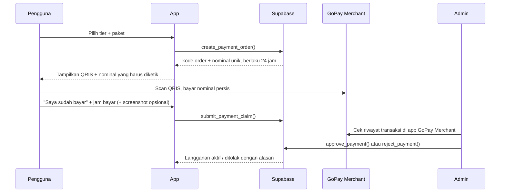

# PRD: Model Monetisasi SevnQuest / Nihongo Quest

Versi: 0.2 (revisi dari draft 0.1)
Tanggal: 4 November 2026
Status: Draft untuk review

---

## 0. Perubahan dari versi 0.1

| # | Versi 0.1 | Versi 0.2 | Alasan |
|---|---|---|---|
| 1 | Gateway Midtrans/Xendit, langganan otomatis, webhook | **QRIS statis GoPay Merchant**, bayar per periode, verifikasi manual oleh admin | QRIS yang tersedia adalah QRIS statis. QRIS statis tidak mengirim webhook dan tidak bisa menagih otomatis tiap bulan. |
| 2 | Konten: Map 1 Stage 1–5, 132 pola, 924 soal (data N3 GATE) | Konten mengikuti isi repo ini: N5–N1, Tower 100 lantai, Library, Recall, Arcade, Dungeon | Angka di 0.1 berasal dari N3 GATE, bukan dari repo `sevnquest`. Peta stage tidak ada di repo ini. |
| 3 | 10 level = 10 rank leaderboard (Minarai → Kami), donatur = rank 4–10 | Level donatur punya badge sendiri, **tidak** memakai rank belajar | Repo memakai 10 tier RPG berbasis EXP (Villager → Mythic Deity). Memakai rank yang sama untuk donatur bertentangan dengan aturan "donasi bukan pay-to-win". |
| 4 | Kuota Kaiwa AI (Gemini) per tier | Kaiwa dikeluarkan dari tier. Fitur AI yang ada: **Deck AI** | Tidak ada fitur Kaiwa maupun integrasi Gemini di repo ini. |
| 5 | "Akses dicek di Edge Function, data diverifikasi di backend" | Gating dua jenis: **lunak** (konten yang dibundel di klien) dan **keras** (fitur server) | Konten dibundel di JS dan bisa dipakai offline; tamu bisa bermain penuh tanpa login. Konten tidak bisa dikunci di backend tanpa memindahkan data ke server. |
| 6 | Tidak menyebut kanal donasi yang sudah ada | Trakteer (`teer.id/sevnsoul`) di Pengaturan ikut diputuskan | Sudah ada tombol "Dukung Developer" di `SettingsView`. |

---

## 1. Ringkasan

Web app belajar bahasa Jepang (JLPT N5–N1) dengan dua lapisan monetisasi:

1. **Tier Akses (3 level):** Basic, Medium, Full. Menentukan konten dan fitur yang bisa dipakai.
2. **Tier Donatur (7 level, D1–D7):** Dibayar tambahan di atas tier akses. Benefitnya kosmetik dan komunitas, terpisah dari rank belajar.

Pembayaran memakai QRIS statis milik merchant:

| Data | Nilai |
|---|---|
| Penyedia | GoPay Merchant (QRIS, diterima semua e-wallet dan m-banking) |
| Nama merchant | SEVNSOUL STORE, DIGITAL & KREATIF |
| NMID | ID1026625677186 |
| Terminal | A01 |

Tujuan:
- Ada pemasukan rutin untuk menutup biaya Supabase, API LLM (Deck AI), dan pengembangan konten.
- Pengguna gratis tetap mendapat pengalaman belajar yang utuh di level awal.
- Donasi terasa sebagai dukungan, bukan membeli kemenangan di papan skor belajar.

---

## 2. Kondisi Produk Saat Ini (repo `sevnquest`)

Sumber: `docs/audit/FEATURE_INVENTORY.md` dan `docs/audit/SYSTEM_OVERVIEW.md`.

| Komponen | Isi | Status |
|---|---|---|
| Kotoba | 18.353 entri (N5 700, N4 731, N3 1.960, N2 3.333, N1 11.369, Kaigo 229, SSW 31) | Aktif |
| Kanji | 2.507 entri (N5 80, N4 167, N3 366, N2 378, N1 1.373, kana 143) | Aktif |
| Bunpou | 915 pola (N5 119, N4 189, N3 132, N2 208, N1 267) | Aktif |
| Bank soal | kanji_questions 7.754, bunpou_questions 2.525 | Aktif |
| Tryout | 27 resmi + 10 dalam-app | Aktif |
| Tower | 100 lantai (Menara 1: 001–016, Menara 2: 017–100) | Aktif |
| Recall (SRS) | 40 jawaban/hari, 10 materi baru/hari, Latihan Ekstra tanpa batas | Aktif |
| Arcade (5 mode), Dungeon (11 jenis) | | Aktif |
| Deck AI | LLM memperluas kata kunci; tanpa env jatuh ke pencocokan lokal | Aktif, opsional |
| Imersi YouTube | Caption lewat endpoint tak resmi, bisa diblokir | Aktif, rapuh |
| Choukai | `CHOUKAI_ENABLED=false` | **Nonaktif** (masalah audio) |
| Leaderboard | All-time dan mingguan, hanya untuk pengguna login | Aktif |

Fakta arsitektur yang berdampak ke monetisasi:
- Konten dibundel di JS dan disimpan PWA, sehingga bisa dipakai offline.
- Tamu (tanpa login) bermain penuh secara lokal. Status langganan butuh login.
- Backend: Supabase (Auth, Postgres + RLS, RPC `SECURITY DEFINER`) dan Cloudflare Pages Functions (`functions/`). Tidak ada Supabase Edge Function.
- Supabase diakses lewat proxy `/supabase-proxy` karena beberapa ISP memblokir `*.supabase.co`.

**Implikasi:** Tier berbayar tidak boleh menjanjikan konten yang belum ada. Choukai baru masuk tier setelah diaktifkan kembali dan lolos uji.

---

## 3. Tujuan & Non-Tujuan

### Tujuan
- Pengguna baru bisa mencoba produk secara gratis tanpa batas waktu.
- Harga berbayar terjangkau untuk pelajar Indonesia (mulai Rp 15.000/bulan).
- Struktur tier mudah dipahami dalam satu layar.
- Papan donatur terpisah dari papan skor belajar.
- Pembayaran sampai aktif dalam waktu wajar walau verifikasi manual (target median < 12 jam).

### Non-Tujuan (versi ini)
- Tidak membuat sistem afiliasi atau referral.
- Tidak ada iklan di dalam app.
- Tidak ada perpanjangan otomatis (auto-debit).
- Tidak ada payment gateway berbayar. Bisa ditambah nanti bila volume transaksi membuat verifikasi manual tidak sanggup.
- Tidak memindahkan konten ke server untuk penguncian keras (lihat 6.4).

---

## 4. Tier Akses

Usulan pembagian berdasarkan isi repo saat ini. Angka final diputuskan di Pertanyaan Terbuka no. 2.

| Tier | Harga | Konten | Fitur |
|---|---|---|---|
| **Basic** | Gratis | Semua materi N5 dan N4 (Library, Tower, Recall), Tower lantai 001–016 | Recall dengan batas harian saat ini (40 jawaban, 10 materi baru), Arcade, leaderboard, cloud sync |
| **Medium** | Rp 15.000 / bulan | + Materi N3 (132 pola, 366 kanji, 1.960 kotoba), seluruh Tower, semua Dungeon | + Latihan Ekstra Recall tanpa batas, tryout N5–N3, statistik lengkap |
| **Full** | Rp 35.000 / bulan | + Materi N2 dan N1, semua tryout, Choukai saat aktif kembali | + Deck AI, Imersi YouTube, early access fitur baru |

Paket periode (QRIS statis tidak bisa menagih otomatis, jadi pengguna membeli masa aktif di muka):

| Paket | Medium | Full |
|---|---|---|
| 1 bulan | Rp 15.000 | Rp 35.000 |
| 3 bulan | Rp 42.000 | Rp 99.000 |
| 12 bulan | Rp 150.000 | Rp 350.000 |

Catatan:
- Pembelian baru saat masih aktif **menambah** masa aktif, tidak menimpa.
- Naik dari Medium ke Full saat masih aktif: sisa hari Medium dikonversi proporsional ke hari Full.
- Pengguna yang sudah memakai materi tier atas sebelum monetisasi berlaku tetap menyimpan progresnya. Materi itu hanya terkunci untuk latihan baru.

---

## 5. Tier Donatur

Tier donatur adalah pembayaran tambahan di atas tier akses. Pengguna harus punya tier Medium atau Full yang aktif untuk ikut donatur.

| Level | Nama badge (usulan) | Harga / bulan | Benefit |
|---|---|---|---|
| D1 | Sakura | Rp 25.000 | Badge donatur, nama di papan donatur |
| D2 | Ume | Rp 50.000 | + Frame avatar khusus |
| D3 | Take | Rp 75.000 | + Voting topik konten berikutnya |
| D4 | Matsu | Rp 100.000 | + Nama tampil di halaman utama |
| D5 | Tsuki | Rp 150.000 | + Prioritas antrian request konten |
| D6 | Taiyou | Rp 250.000 | + Sesi feedback 1-on-1 (per bulan) |
| D7 | Fuji | Rp 500.000 | + Semua benefit sebelumnya + nama di kredit app |

Nama badge hanya contoh dan tidak memakai nama tier RPG (Villager … Mythic Deity) maupun rank leaderboard.

### Aturan "prioritas"
- Prioritas berarti **urutan antrian request konten dan voting**, bukan posisi di papan skor belajar.
- Papan skor belajar (EXP, skor mingguan) tetap murni berdasarkan performa.
- Tier RPG tetap hanya dari EXP dan gerbang ascension. Donasi tidak memberi EXP, gold, atau bonus apa pun yang memengaruhi skor.
- Papan donatur tampil terpisah dan menampilkan level D1–D7 beserta nama.

### Hubungan dengan Trakteer
Tombol "Dukung Developer" (Trakteer) di Pengaturan sudah ada. Pilihan:
- (a) Trakteer tetap untuk donasi sekali bayar tanpa benefit, QRIS untuk tier donatur.
- (b) Trakteer diganti seluruhnya dengan QRIS.

Diputuskan di Pertanyaan Terbuka no. 1.

---

## 6. Fitur Teknis

### 6.1 Alur pembayaran (QRIS statis + verifikasi manual)

Detail:
- **Nominal unik.** QRIS statis tidak membawa ID pesanan, jadi transaksi dicocokkan lewat nominal. Harga dikurangi kode unik 1–99 (contoh Medium 1 bulan: Rp 14.937). Pengguna tidak pernah membayar di atas harga daftar. Kode unik tidak boleh sama di antara order `pending` dengan harga dasar yang sama. Bila 99 kode habis, pakai 3 digit.
- **Masa berlaku order:** 24 jam. Setelah itu status `expired` dan kode unik dilepas.
- **Klaim:** pengguna mengisi jam bayar dan boleh mengunggah screenshot. Screenshot hanya bukti pendukung. Admin wajib mencocokkan ke riwayat transaksi GoPay Merchant karena screenshot mudah dipalsukan.
- **Nominal tidak cocok** (salah ketik): admin bisa menyetujui manual bila jumlah ≥ harga paket dikurangi kode unik dan transaksinya bisa diidentifikasi. Bila kurang, ditolak dan diarahkan ke kontak dukungan.
- **Bayar tanpa klaim:** transaksi yang cocok dengan order `pending` boleh disetujui admin tanpa menunggu klaim.
- **Notifikasi:** status order tampil di app. Notifikasi email opsional (fase 2).

Opsi fase 2: membuat QRIS dengan nominal terisi otomatis dari payload QRIS statis (tag 54, point of initiation 12, hitung ulang CRC). Ini mengurangi salah ketik nominal, tetapi tetap tidak memberi verifikasi otomatis. Wajib diuji di beberapa e-wallet dan bank, dan dicek terhadap ketentuan GoPay Merchant sebelum dipakai.

### 6.2 Data

Tabel baru di Supabase (semua dengan RLS):

| Tabel | Kolom utama | Akses |
|---|---|---|
| `subscription_tiers` | `tier_code`, `type` (access / donor), `level`, `price_idr`, `benefits` (JSON), `active` | Baca: semua. Tulis: admin |
| `payment_orders` | `id`, `order_code`, `user_id`, `tier_code`, `period_months`, `base_price_idr`, `unique_code`, `amount_idr`, `status` (pending / claimed / paid / rejected / expired), `paid_at_reported`, `proof_path`, `reject_reason`, `verified_by`, `verified_at`, `created_at`, `expires_at` | Pengguna: baca baris sendiri. Buat dan klaim hanya lewat RPC |
| `user_subscriptions` | `user_id`, `tier_code`, `starts_at`, `expires_at`, `source_order_id` | Pengguna: baca baris sendiri. Tulis: hanya lewat `approve_payment` |
| `admins` | `user_id` | Tidak bisa dibaca klien |

RPC (`SECURITY DEFINER`, mengikuti pola `upsert_leaderboard_entry`):
- `create_payment_order(tier_code, period_months)`: hitung nominal unik, batasi maksimal 3 order `pending` per pengguna.
- `submit_payment_claim(order_id, paid_at, proof_path)`.
- `approve_payment(order_id)` dan `reject_payment(order_id, reason)`: cek pengguna ada di `admins`. Approve menambah atau memperpanjang `user_subscriptions` dalam satu transaksi.
- `get_my_entitlement()`: kembalikan tier akses, tier donatur, dan tanggal kedaluwarsa.

Bukti bayar disimpan di bucket Storage privat `payment-proofs`, path `<user_id>/<order_id>.jpg`. Pengguna hanya bisa unggah ke foldernya sendiri. Hanya admin yang bisa membaca semua.

### 6.3 Admin
- Halaman admin sederhana di app (hanya tampil bila `get_my_entitlement` atau RPC terpisah menyatakan pengguna adalah admin): daftar order `claimed` dan `pending`, nominal, jam bayar, screenshot, tombol setujui/tolak.
- Admin membuka app GoPay Merchant di sebelahnya untuk mencocokkan.
- Semua keputusan admin tercatat (`verified_by`, `verified_at`, `reject_reason`).

### 6.4 Gating

| Jenis | Berlaku untuk | Cara | Keamanan |
|---|---|---|---|
| **Lunak** | Konten yang dibundel di klien (materi N3–N1, Tower, Dungeon, tryout) | Klien membaca `get_my_entitlement()` saat login, menyimpan hasilnya di cache lokal, menampilkan kunci dan CTA upgrade | Bisa diakali oleh pengguna teknis. Diterima untuk v1. |
| **Keras** | Fitur server: Deck AI (`functions/api/deck-topic.ts`), Imersi (`functions/api/captions.ts`) | Cloudflare Function memverifikasi JWT Supabase dan memanggil `get_my_entitlement` sebelum memanggil LLM atau caption | Tidak bisa diakali dari klien |

- Tag `tier_required` ditambahkan di metadata konten (level JLPT sudah cukup untuk sebagian besar materi: N5/N4 = basic, N3 = medium, N2/N1 = full).
- Cache entitlement berlaku maksimal 7 hari offline. Setelah itu, materi tier atas terkunci sampai app online lagi.
- Tamu (tanpa login) diperlakukan sebagai Basic.
- Penguncian keras untuk konten (memindahkan dataset ke server) di luar lingkup versi ini.

### 6.5 Masa aktif habis
- Pengingat di app pada H-3 dan H-1 sebelum kedaluwarsa.
- Masa tenggang 3 hari setelah kedaluwarsa. Setelah itu akses turun ke Basic.
- Progres, mastery, dan riwayat tidak dihapus. Materi tier atas hanya terkunci untuk latihan baru.

---

## 7. Metrik Keberhasilan

- Konversi Basic → Medium: target 5% pengguna aktif login dalam 30 hari pertama.
- Perpanjangan (bukan retensi auto-renew) bulan ke-3: target 50% pengguna berbayar membeli periode berikutnya.
- Rasio donatur dari pengguna berbayar: target 10%.
- Biaya LLM (Deck AI) per pengguna Full kurang dari 15% harga Full.
- Waktu dari klaim sampai aktif: median < 12 jam, p90 < 24 jam.
- Order `pending` yang kedaluwarsa tanpa bayar: dipantau sebagai indikator kebingungan di alur bayar.

---

## 8. Risiko

| Risiko | Dampak | Mitigasi |
|---|---|---|
| Verifikasi manual tidak sanggup bila transaksi banyak | Aktivasi lambat, keluhan | Target waktu verifikasi. Bila > 30 order/hari selama 2 minggu, pindah ke gateway dengan QRIS dinamis dan webhook. |
| Screenshot bukti palsu | Akses gratis tanpa bayar | Persetujuan wajib dicocokkan dengan riwayat GoPay Merchant, bukan screenshot. |
| Salah ketik nominal / dua order dengan nominal sama | Transaksi tidak bisa dicocokkan | Kode unik per order `pending`, admin bisa approve manual, kontak dukungan. Fase 2: QRIS dengan nominal terisi otomatis. |
| Gating lunak diakali | Sebagian pengguna memakai konten berbayar gratis | Diterima untuk v1. Fitur yang memakan biaya (Deck AI, Imersi) dikunci keras. |
| Pengguna lama merasa dirugikan saat konten dikunci | Komunitas turun | Pengumuman di app sebelum berlaku, progres tetap tersimpan, opsi promo awal untuk pengguna lama. |
| Papan donatur dianggap pay-to-win | Komunitas turun | Papan belajar dan donatur dipisah, badge donatur tidak memakai nama rank. |
| Konten dijual sebelum siap (Choukai) | Kecewa, refund | Choukai tidak dicantumkan di tier sampai aktif kembali. |
| Refund manual | Beban admin | Kebijakan refund tertulis (misal: hanya bila akses gagal aktif dalam 3 hari). |
| Ketentuan dan biaya GoPay Merchant | Potongan atau pembatasan akun | Cek biaya MDR QRIS dan ketentuan penjualan produk digital di akun GoPay Merchant sebelum rilis. |
| Hak cipta materi JLPT/buku | Risiko hukum | Pakai soal yang sudah dipublikasi resmi dan konten buatan sendiri. Atribusi JMdict tetap. |

---

## 9. Pertanyaan Terbuka

1. Trakteer dipertahankan untuk donasi sekali bayar, atau diganti seluruhnya dengan QRIS?
2. Pembagian konten di bagian 4 (N5–N4 gratis, N3 Medium, N2–N1 Full) sudah sesuai, atau N3 perlu sebagian gratis karena target utama app adalah N3?
3. Apakah tier donatur dijual sebagai periode bulanan saja, atau ada opsi sekali bayar / lifetime untuk D7?
4. Apakah papan donatur ditampilkan publik atau hanya di dalam app?
5. Apakah N3 GATE dan NihongoQuest digabung jadi satu produk, atau berdiri sendiri? Bila berdiri sendiri, PRD ini hanya berlaku untuk repo `sevnquest`.
6. Siapa saja admin verifikasi pembayaran, dan pada jam berapa saja order diproses?

---

## 10. Langkah Berikutnya

1. Putuskan Pertanyaan Terbuka no. 1, 2, dan 5.
2. Cek biaya dan ketentuan akun GoPay Merchant untuk penjualan langganan digital.
3. Buat migrasi Supabase: `subscription_tiers`, `payment_orders`, `user_subscriptions`, `admins`, RPC, bucket `payment-proofs`.
4. Buat halaman Upgrade (QRIS + nominal unik + klaim) dan halaman admin.
5. Tambah pengecekan entitlement di `functions/api/deck-topic.ts` dan `functions/api/captions.ts`.
6. Tandai konten dengan `tier_required` dan pasang gating lunak di Library, Tower, Dungeon, dan tryout.
7. Uji alur end-to-end dengan transaksi nyata nominal kecil sebelum rilis.
